# Motion Arena

**Fitness-Bewegungsspiel für Smartphone und Browser.** Die Kamera erfasst die Person, MediaPipe Pose schätzt die
Körperhaltung, Kniebeugen werden live gezählt, verständlich bewertet und mit Punkten und Combos belohnt. Dazu:
die 3D-Trainingsansicht Arena, 10 weitere Ansichten der Körperspiegelung, eine Live-Körperanalyse,
15 Avatare in 20 Trainingsräumen und ein TV-Modus.
Die Erkennung läuft lokal auf dem Gerät – Kamerabild und Bewegungsdaten verlassen das Handy nur, wenn du selbst einen
Fernseher koppelst (dann direkt zu diesem, das Bild nur mit deiner Zustimmung).

Designrichtung **Kinetic Studio**: dunkles Petrol/Graphit, warmes Weiß, Korallorange als Akzent, Türkis für die
Körperspiegelung.

<table align="center"><tr>
<td align="center" width="200"></td>
<td>
<b>📲 Auf dem Handy installieren:</b> QR-Code mit der Handykamera scannen<br/>
oder <a href="https://youra82.github.io/motion_arena/?install=1"><b>youra82.github.io/motion_arena</b></a> öffnen →
„Jetzt installieren“ (Android) bzw. Teilen → „Zum Home-Bildschirm“ (iPhone).<br/>
<sub>Kein PC nötig, danach auch offline. Kamera und Erkennung laufen nur auf dem Handy.</sub>
</td>
</tr></table>

> **Stand:** Version 0.2 – Übung Kniebeuge, 3D-Arena, Startseite mit Fortschritt, Live-Körperanalyse,
> TV-Modus, Avatare und Räume. Abgesichert mit 242 Unit-Tests und 34 Browsertests. **Noch nicht erfolgt:** der Test mit einer echten Person vor einer echten Handykamera und auf
> einem echten Fernseher – siehe [Status](docs/STATUS.md).

<p align="center">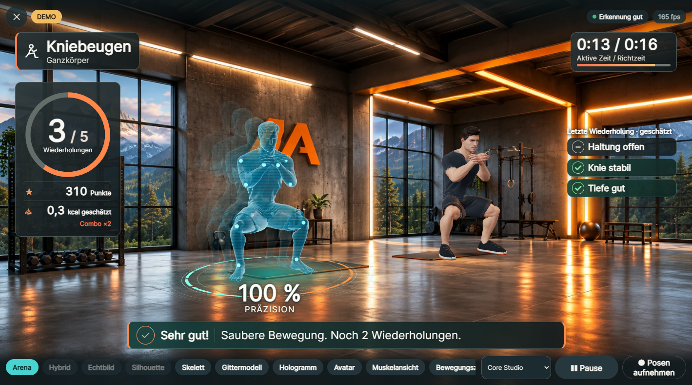</p>
<p align="center">
  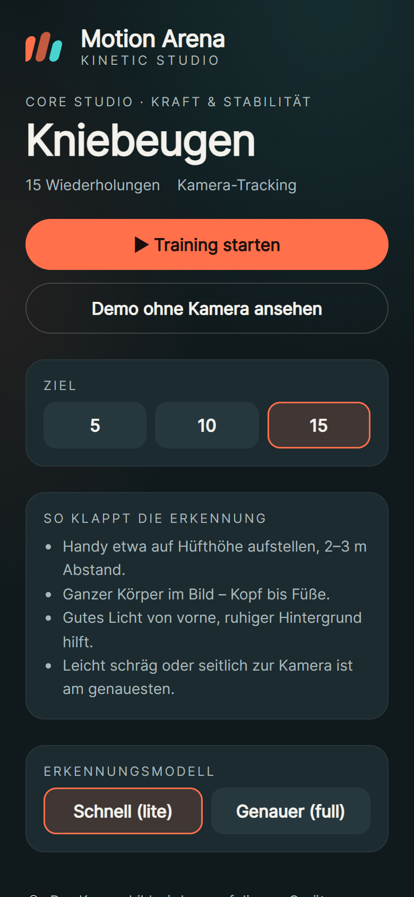
  
  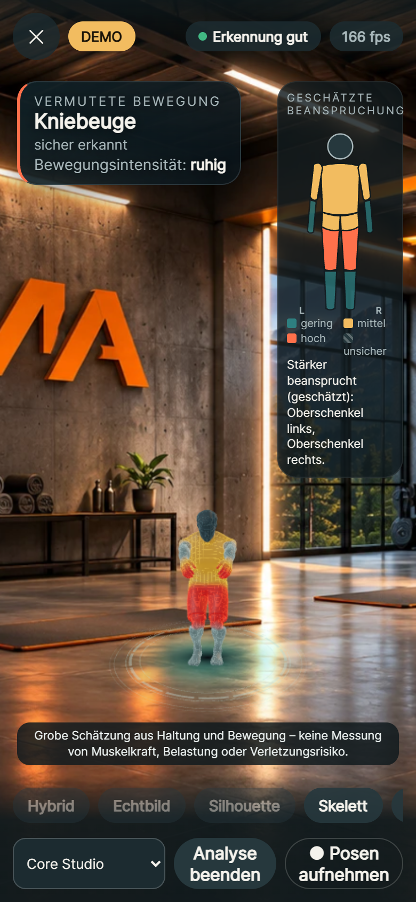
  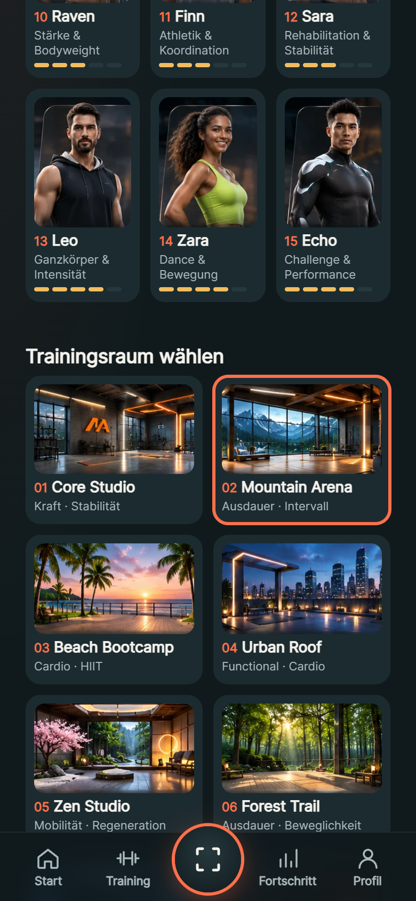
</p>
<p align="center">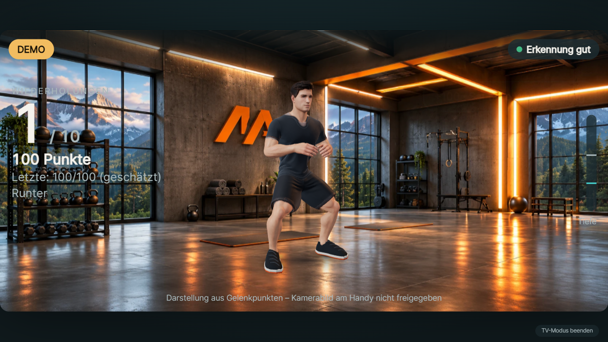</p>
<p align="center"><sub>Alle Bildschirme der App: <a href="#galerie">Galerie</a>. Screenshots automatisch erzeugt (Demo-Modus mit synthetischer Bewegung bzw. Chrome-Testkamera – keine echte Person).</sub></p>

---

## Inhalt

- [Funktionen](#funktionen)
- [Galerie](#galerie)
- [Auf dem Fernseher anzeigen](#auf-dem-fernseher-anzeigen)
- [Installation](#installation) – Handy per QR-Code, Windows automatisch, manuell, Dauerbetrieb, [Fehlerbehebung](#fehlerbehebung)
- [So funktioniert die Erkennung](#so-funktioniert-die-erkennung)
- [Bewertung und Punkte](#bewertung-und-punkte)
- [Architektur](#architektur)
- [Datenschutz](#datenschutz)
- [Tests](#tests)
- [Echte Aufnahmen als Testfälle](#echte-aufnahmen-als-testfälle)
- [Qualitätssicherung mit Codex](#qualitätssicherung-mit-codex)
- [Grenzen – was die Kamera nicht kann](#grenzen--was-die-kamera-nicht-kann)
- [Roadmap](#roadmap)
- [Projektdokumente](#projektdokumente)

---

## Funktionen

| Bereich | Was die App macht |
| --- | --- |
| **Kamera & Pose** | Frontkamera über `getUserMedia`, MediaPipe Pose Landmarker (Modell *lite* oder *full*, GPU mit automatischem CPU-Rückfall), 33 Körperpunkte plus 3D-Weltkoordinaten |
| **Kalibrierung** | Person steht 1,5 s ruhig und vollständig im Bild (Kopf bis Füße). Erkennt Blickwinkel (frontal/schräg/seitlich) und speichert Referenzwerte. Startet neu bei Bewegung, Lücken oder Hocke |
| **Kniebeugen-Zähler** | Zustandsmaschine mit Hysterese: *Stand → Abstieg → Aufstieg → Stand*. Zählt erst beim Wiederaufrichten, toleriert Wippen am Tiefpunkt, ignoriert Zittern an den Schwellen |
| **Fehlversuche** | „Zu flach“ und „zu schnell“ werden erkannt, nicht gezählt und kurz erklärt |
| **Unsichere Erkennung** | Teilkörper, geringe Konfidenz, Kameralücken, Blickwinkelwechsel → **Warnung statt Wertung**, keine Strafpunkte, Combo bleibt erhalten |
| **Bewertung** | Schematische Punkte 0–100 aus Tiefe, Kontrolle, Links/Rechts-Symmetrie und (nur seitlich) Haltung, jeweils mit Hinweis „geschätzt“ |
| **Spiel** | Punkte, Combo-Bonus bis +50 %, Ziel 5/10/15/20 Wiederholungen, Countdown, Pause, Ergebnisseite |
| **3D-Arena** | 20 Raummotive plus Lebombo, animierter Kniebeugen-Trainer, leuchtendes Hologramm mit Nachbildern, Präzisionsring und Trainingsanzeige. Standard für neue Einstellungen und Demo. |
| **Startseite & Fortschritt** | Startseite im Kinetic-Studio-Stil mit Versionsnummer, Bewegungspräzision des letzten Trainings, Wochenplan mit Wochenziel, 30-Tage-Challenge, Serie, Verlauf der letzten 14 Tage. Nur echte Kamera-Trainings zählen; gespeichert nur auf dem Gerät (höchstens 1000 Einträge) |
| **10 Ansichten** | Echtbild, grüne Silhouette, geteilte Hybridansicht aus freigestelltem Kamerabild und Hologramm, Skelett, Gittermodell, Hologramm, Avatar, Muskelansicht (geschätzte Beanspruchung), Bewegungszonen (Bewegungsintensität), Bewegungsspur. Die geriggte 3D-Figur folgt den erkannten Körperpunkten. |
| **Live-Körperanalyse** | Freier Modus ohne Übung: erkennt Stehen, Kniebeuge, Einbeinstand, Ausfallschritt, Hampelmann, Arme heben, Stütz – sonst „unbekannt“ statt geraten. Trennt **Bewegungsintensität** von **vermuteter Beanspruchung** je Körperzone (gering/mittel/hoch/unsicher, keine Prozente), Körperschema mit deiner linken/rechten Seite |
| **Avatare & Räume** | 20 Trainingsräume (Core Studio … Sunrise Deck) als fotografische Kulisse der Arena – Figuren stehen je Raum auf dem Boden (Standhöhe je Raumbild, bei Bedarf Plattform). Als 3D-Figur animiert ist Trainer Lukas (CC0-Modell, ausstaffiert); die 15 Avatare (Lukas … Echo) erscheinen als Porträtkarten. Quellen und Lizenzen: [docs/ASSETS.md](docs/ASSETS.md) |
| **TV-Modus** | Fernseher zeigt **dasselbe wie die App** – gleiche Anzeige im gleichen Seitenverhältnis, mit Zustimmung als Live-Bild 1:1. Kopplung per QR-Code (sofort) oder Code (Bestätigung am Fernseher), direkt per WebRTC |
| **Signaturen** | Präzisionsring am Boden (zeigt die Beugetiefe, leuchtet bei gezählter Wiederholung), Bewegungsspur mit Nachbildern |
| **Installierbar** | Per QR-Code auf dem Handy installieren: Android mit einem Tipp („Jetzt installieren“), iPhone mit geführter Anleitung. Startet ohne Browserleiste und funktioniert danach **offline** (Service Worker speichert App, Erkennung und Modell) |
| **Demo-Modus** | Synthetische Kniebeugen ohne Kamera, deutlich als **DEMO** gekennzeichnet |
| **Posen-Aufnahme** | Speichert nur Gelenkkoordinaten (keine Bilder) als Datei – für reproduzierbare Tests mit echten Bewegungen |
| **Fehlerzustände** | Kamera verweigert / nicht vorhanden / belegt / getrennt, Modell lädt nicht, kein HTTPS – jeweils mit Ausweg (Erneut, Demo, Zurück); Laden jederzeit abbrechbar |

---

## Galerie

Jeder Bildschirm und Zustand, den die App darstellen kann. Die Bilder erzeugt `pnpm screenshots`
([tests/screenshots/](tests/screenshots/)) automatisch – nach jeder Oberflächenänderung neu erzeugbar.
**Demo-Bilder** zeigen synthetische Bewegung, **Kamera-Bilder** die Chrome-Testkamera ohne Person, der Verlauf unter
„Fortschritt“ ist ein Beispiel.

### 3D-Arena

<p align="center">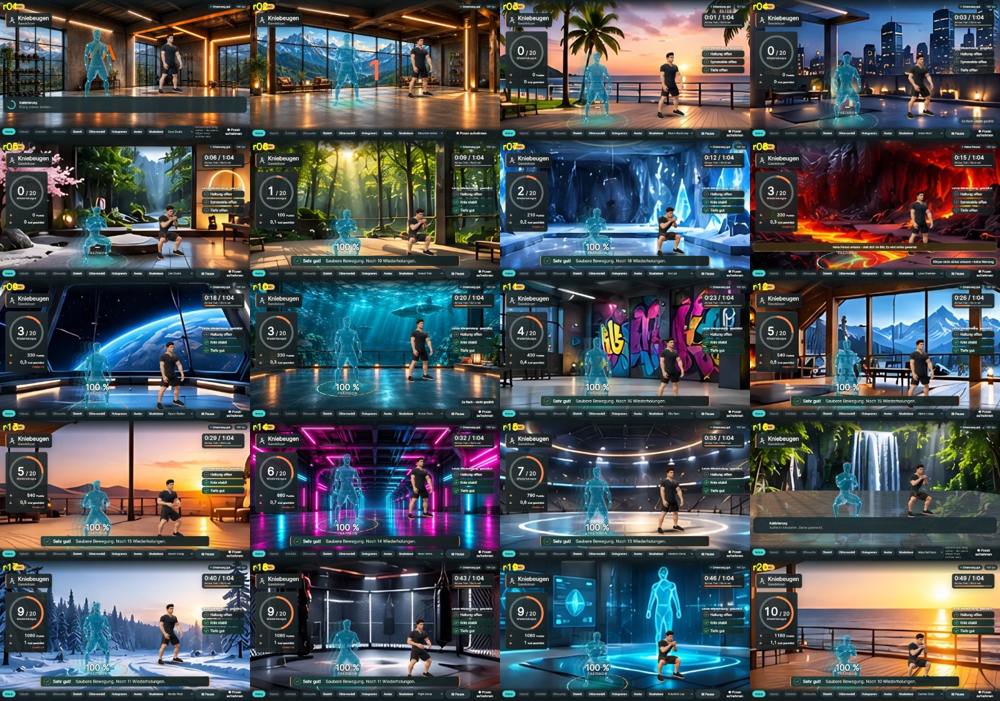<br/>
<sub>Die Arena in allen 20 Räumen (Demo): Hologramm-Spieler und Trainer stehen jeweils auf dem Boden des Raumbilds.</sub></p>

<table>
<tr><td align="center" valign="top" width="50%">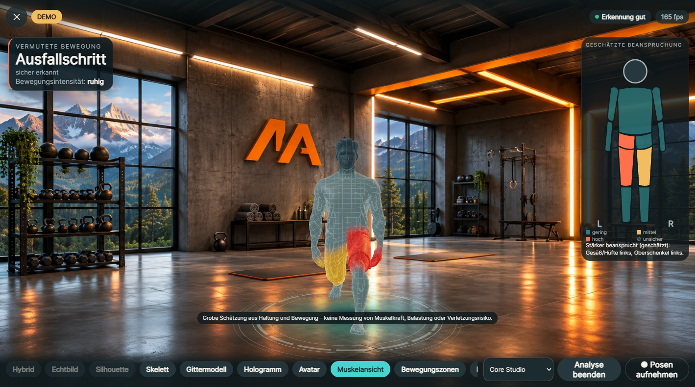<br/><b>3D-Körperanalyse</b><br/><sub>Vermutete Bewegung und geschätzte Beanspruchung auf der Figur</sub></td>
<td align="center" valign="top" width="50%">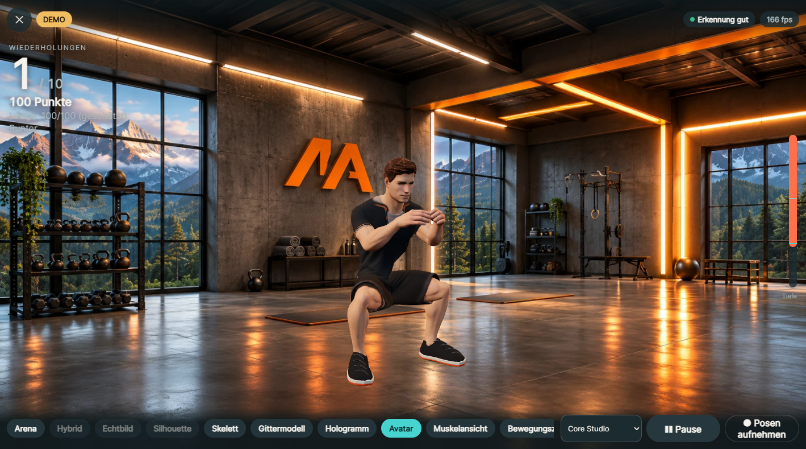<br/><b>Ansicht „Avatar“</b><br/><sub>Lukas als 3D-Figur folgt der Bewegung</sub></td></tr>
</table>

### Startseite und Bereiche

<table>
<tr><td align="center" valign="top" width="33%"><br/><b>Startseite</b><br/><sub>Nächstes Training, Ziel 5–20, Bewegungspräzision, Versionsnummer oben rechts</sub></td><td align="center" valign="top" width="33%"><br/><b>Startseite (ganz)</b><br/><sub>Körperanalyse, Fernseher, Bereiche, Challenge, Datenschutz</sub></td><td align="center" valign="top" width="33%">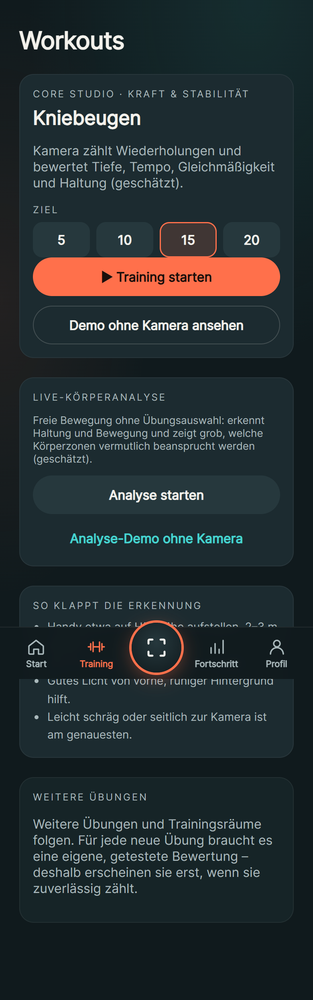<br/><b>Workouts</b><br/><sub>Kniebeuge mit Ziel, Live-Körperanalyse, Tipps zur Aufstellung</sub></td></tr>
<tr><td align="center" valign="top" width="33%">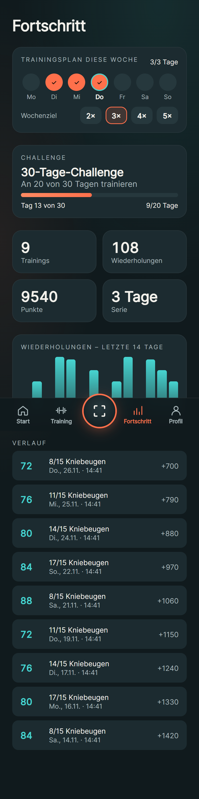<br/><b>Fortschritt</b><br/><sub>Wochenplan, 30-Tage-Challenge, Kennzahlen, letzte 14 Tage, Verlauf</sub></td><td align="center" valign="top" width="33%">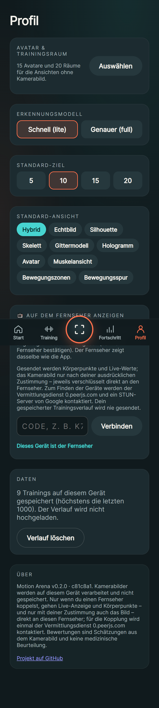<br/><b>Profil</b><br/><sub>Avatar & Raum, Modell, Standard-Ziel und -Ansicht, Fernseher, Verlauf löschen</sub></td><td align="center" valign="top" width="33%"><br/><b>Avatar & Raum</b><br/><sub>15 Avatare, 20 Räume, animierte Vorschau</sub></td></tr>
</table>

<p align="center">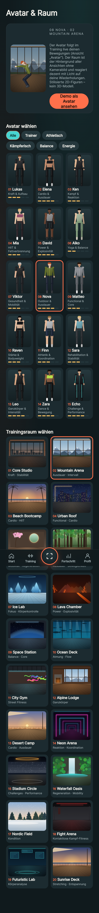<br/>
<sub>Alle 15 Avatare (filterbar nach Trainer, Athletisch, Kämpferisch, Balance, Energie) und alle 20 Trainingsräume.</sub></p>

### Kalibrierung und Countdown

<table>
<tr><td align="center" valign="top" width="33%">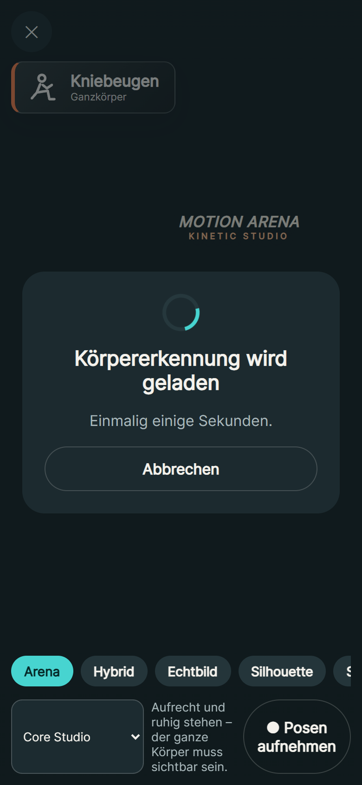<br/><b>Laden</b><br/><sub>Körpererkennung wird lokal geladen – jederzeit abbrechbar</sub></td><td align="center" valign="top" width="33%">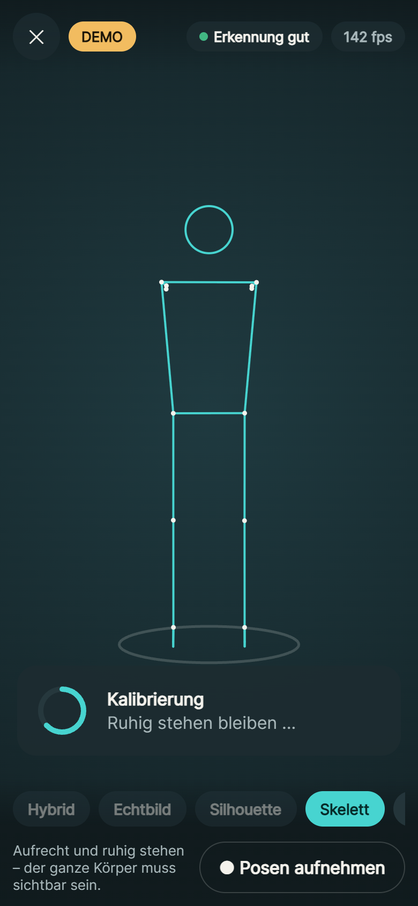<br/><b>Kalibrierung</b><br/><sub>1,5 s ruhig stehen, Fortschrittsring, Hinweise bei Fehlern</sub></td><td align="center" valign="top" width="33%">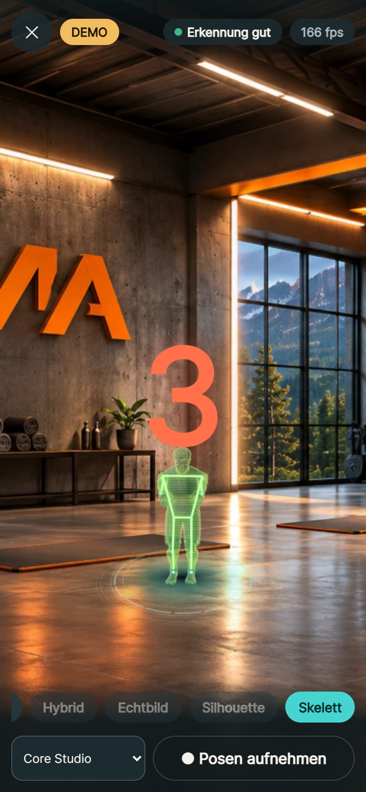<br/><b>Countdown</b><br/><sub>3-2-1, wartet, solange die Person nicht sicher erkannt wird</sub></td></tr>
</table>

### Training

<p align="center"><br/>
<sub>3D-Arena im Core Studio, aufgenommen im laufenden Demo-Training. <a href="docs/ASSETS.md">Grafikquellen</a></sub></p>

<table>
<tr><td align="center" valign="top" width="33%"><br/><b>Wiederholung gezählt</b><br/><sub>Zähler, Punkte, Rückmeldung, leuchtender Präzisionsring, Raumlicht</sub></td><td align="center" valign="top" width="33%"><br/><b>Zu flach</b><br/><sub>Nicht gezählt, kurze Erklärung, Combo endet ohne Punktabzug</sub></td><td align="center" valign="top" width="33%">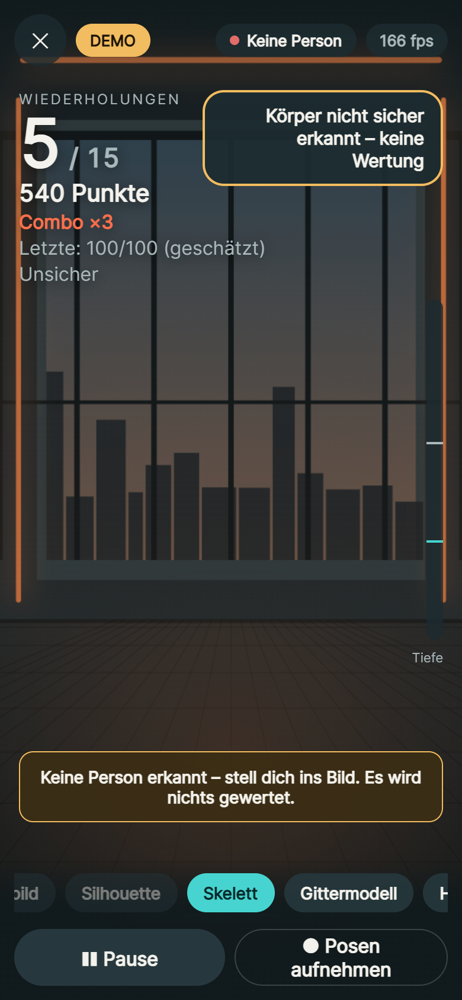<br/><b>Warnung statt Wertung</b><br/><sub>Person verschwindet: Banner, keine Wertung, Combo bleibt</sub></td></tr>
<tr><td align="center" valign="top" width="33%">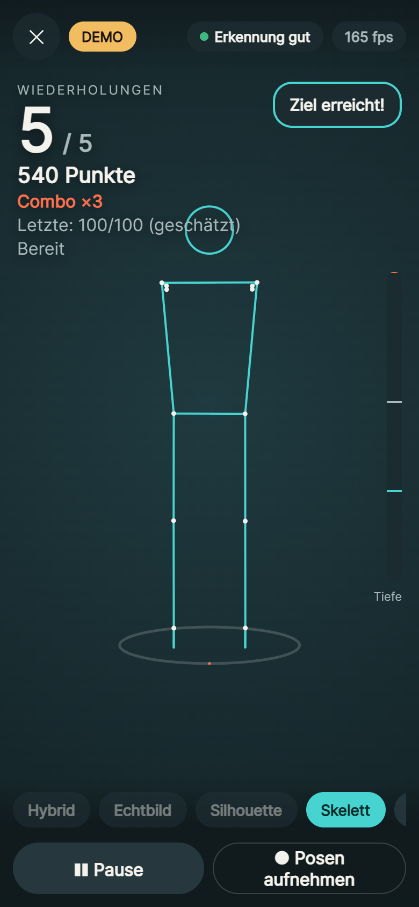<br/><b>Ziel erreicht</b><br/><sub>Letzte Wiederholung, danach automatisch zum Ergebnis</sub></td><td align="center" valign="top" width="33%">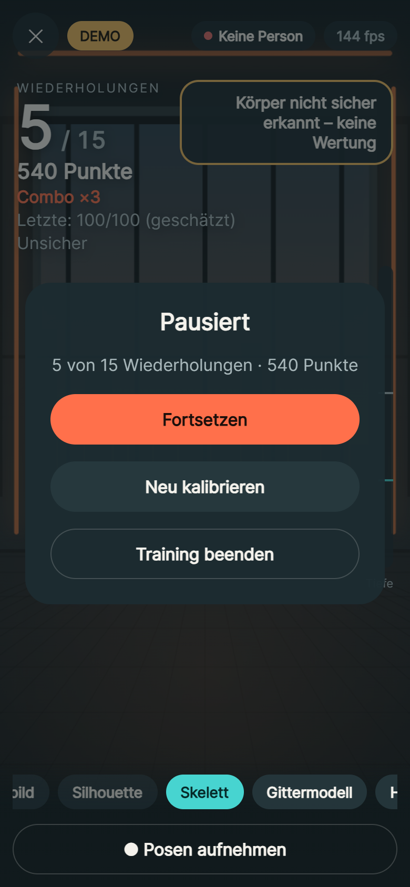<br/><b>Pause</b><br/><sub>Fortsetzen, neu kalibrieren oder beenden</sub></td><td align="center" valign="top" width="33%"><br/><b>Ergebnis</b><br/><sub>Wiederholungen, Punkte, Ø-Bewertung, Combo, Zeit, nicht gezählte Versuche</sub></td></tr>
<tr><td align="center" valign="top" width="33%"><br/><b>Ergebnis: Ziel erreicht</b><br/><sub>Liste aller Wiederholungen mit Hinweisen und Punkten</sub></td><td align="center" valign="top" width="33%"><br/><b>Kamera verweigert</b><br/><sub>Verständlicher Fehler mit Ausweg: erneut, Demo oder zurück</sub></td><td align="center" valign="top" width="33%"><br/><b>Keine Person (Kamera)</b><br/><sub>Status „Keine Person“ – es wird nichts gewertet</sub></td></tr>
</table>

### Die 10 Ansichten

<table>
<tr><td align="center" valign="top" width="33%"><br/><b>Hybrid</b><br/><sub>Kamerabild + Skelett</sub></td><td align="center" valign="top" width="33%"><br/><b>Echtbild</b><br/><sub>Ganzes Kamerabild, gespiegelt wie ein Selfie</sub></td><td align="center" valign="top" width="33%"><br/><b>Silhouette</b><br/><sub>Lokale Personenmaske – ohne Person bleibt sie leer</sub></td></tr>
<tr><td align="center" valign="top" width="33%"><br/><b>Skelett</b><br/><sub>Gelenkpunkte im Trainingsraum</sub></td><td align="center" valign="top" width="33%">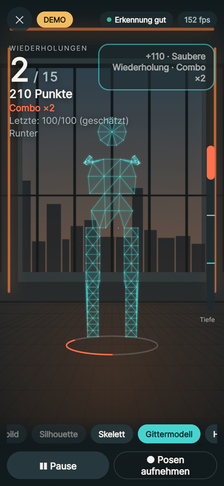<br/><b>Gittermodell</b><br/><sub>Triangulierte Körperhülle</sub></td><td align="center" valign="top" width="33%">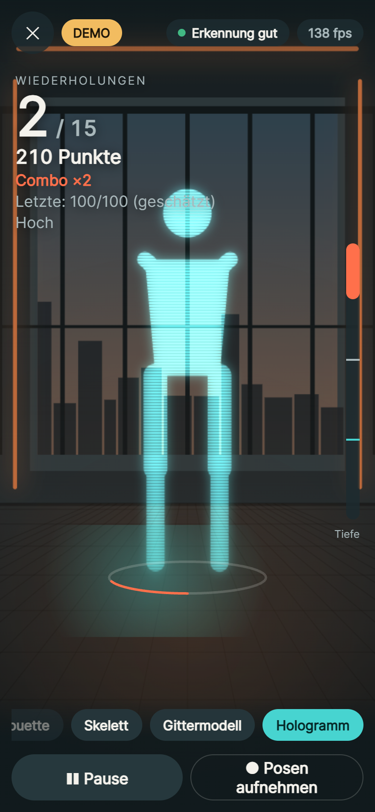<br/><b>Hologramm</b><br/><sub>Leuchtende Körperform mit Scanlines (ruhig bei „Bewegung reduzieren“)</sub></td></tr>
<tr><td align="center" valign="top" width="33%">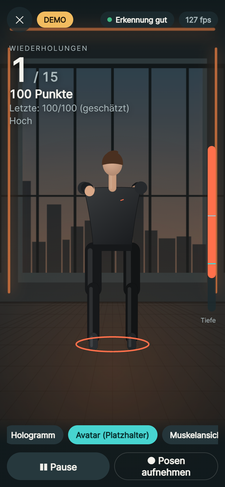<br/><b>Avatar</b><br/><sub>Gewählter Avatar folgt live der Bewegung (stilisiert 2D)</sub></td><td align="center" valign="top" width="33%">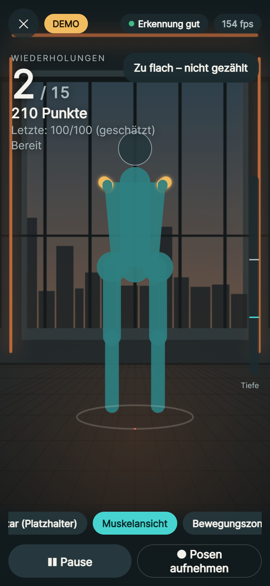<br/><b>Muskelansicht</b><br/><sub>Geschätzte Beanspruchung je Zone – keine Messung</sub></td><td align="center" valign="top" width="33%">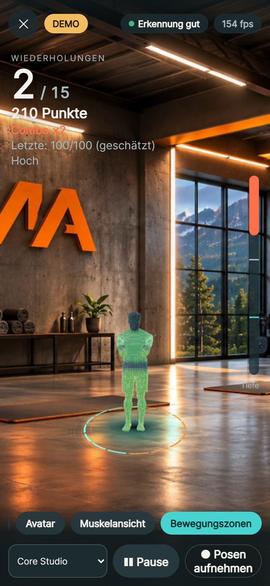<br/><b>Bewegungszonen</b><br/><sub>Bewegungsintensität der Gelenke (Geschwindigkeit)</sub></td></tr>
<tr><td align="center" valign="top" width="33%"><br/><b>Bewegungsspur</b><br/><sub>Nachbilder der letzten Posen (Motion-Spur)</sub></td></tr>
</table>

### Live-Körperanalyse

<p align="center"></p>

<table>
<tr><td align="center" valign="top" width="33%"><br/><b>Kniebeuge erkannt</b><br/><sub>Vermutete Bewegung, Intensität, Körperschema mit L/R</sub></td><td align="center" valign="top" width="33%">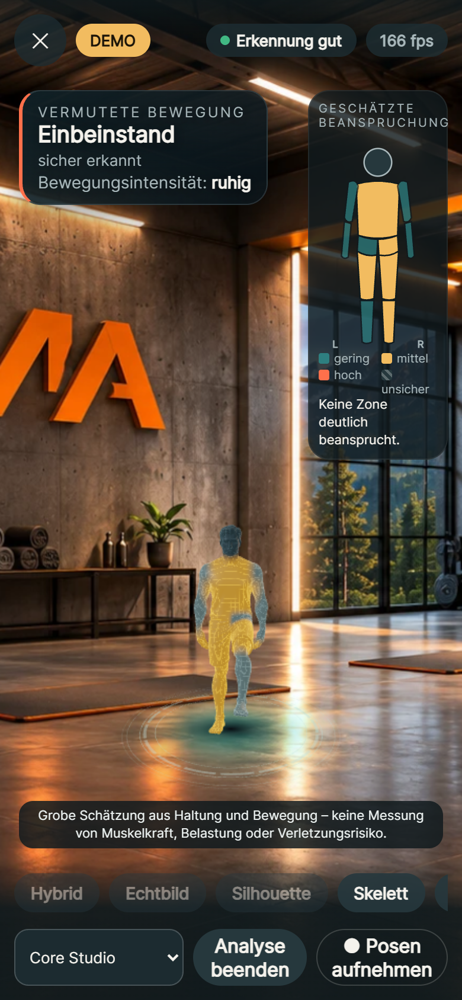<br/><b>Einbeinstand erkannt</b><br/><sub>Standbein stärker beansprucht (geschätzt)</sub></td></tr>
</table>

### Auf dem Fernseher

<table>
<tr><td align="center" valign="top" width="33%">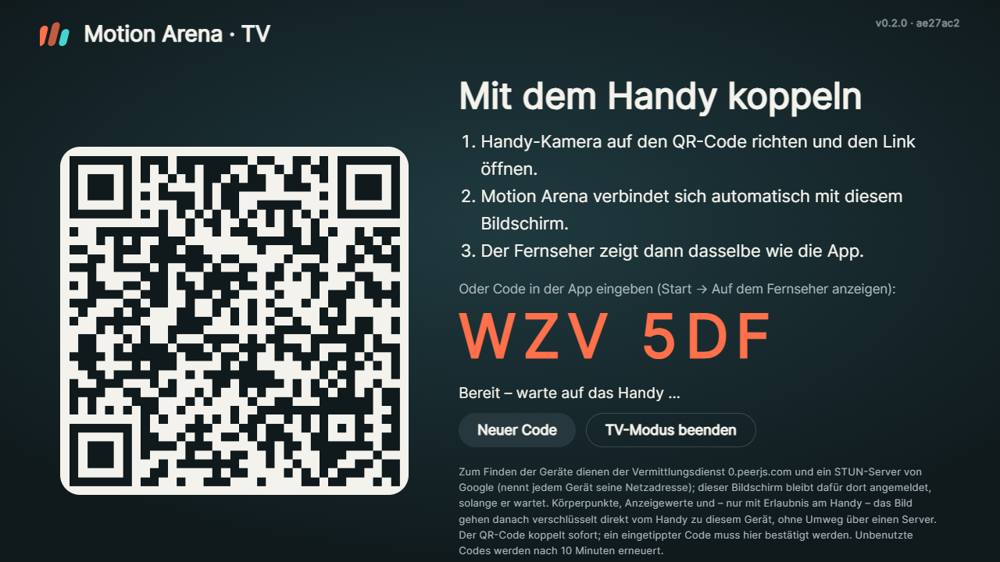<br/><b>TV wartet</b><br/><sub>QR-Code (koppelt sofort) und Code zum Eintippen</sub></td><td align="center" valign="top" width="33%">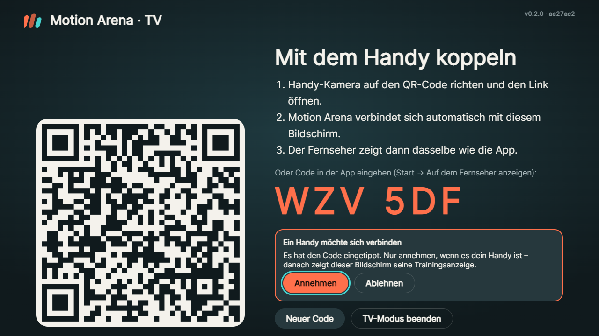<br/><b>Code eingetippt</b><br/><sub>Am Fernseher annehmen oder ablehnen – Knopf für die Fernbedienung ausgewählt</sub></td><td align="center" valign="top" width="33%">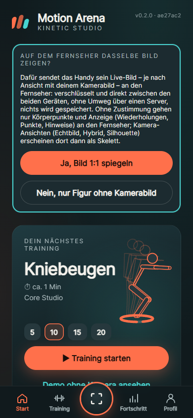<br/><b>Zustimmung am Handy</b><br/><sub>Bild 1:1 spiegeln oder nur Figur ohne Kamerabild</sub></td></tr>
<tr><td align="center" valign="top" width="33%"><br/><b>Spiegelung</b><br/><sub>Fernseher zeigt dieselbe Anzeige wie das Handy (hier: Figur im Raum)</sub></td><td align="center" valign="top" width="33%">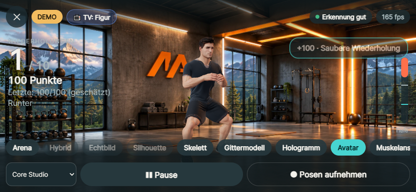<br/><b>Handy sendet</b><br/><sub>„📺 TV: Figur/Bild“ zeigt, dass gesendet wird</sub></td><td align="center" valign="top" width="33%">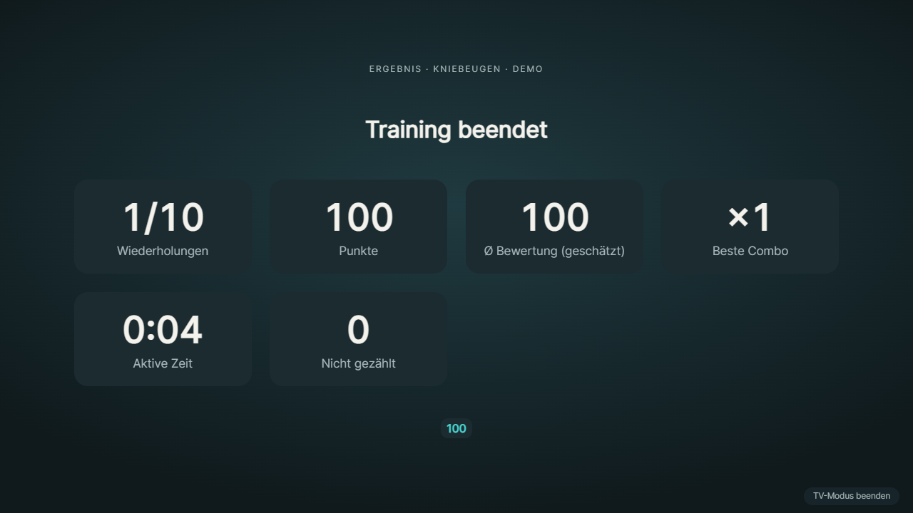<br/><b>Ergebnis am TV</b><br/><sub>Wie am Handy, inklusive DEMO-Kennzeichnung und Einzelwertungen</sub></td></tr>
</table>

### Installation auf dem Handy

<table>
<tr>
<td align="center" valign="top" width="33%">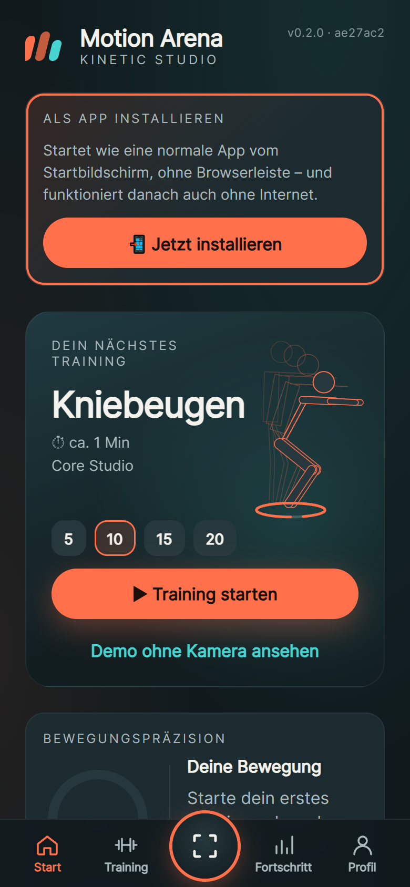<br/><b>Android</b><br/><sub>Nach dem QR-Scan: hervorgehobene Karte, ein Tipp öffnet den Installationsdialog</sub></td>
<td align="center" valign="top" width="33%">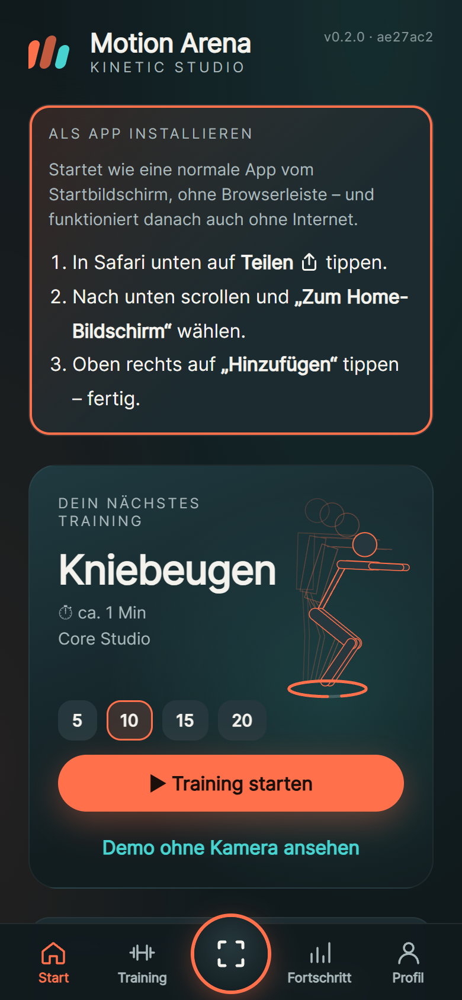<br/><b>iPhone</b><br/><sub>Geführte Schritte über Teilen → „Zum Home-Bildschirm“</sub></td>
<td align="center" valign="top" width="33%"><br/><b>QR-Code</b><br/><sub>Führt direkt zur installierbaren App</sub></td>
</tr>
</table>

### Querformat

<p align="center">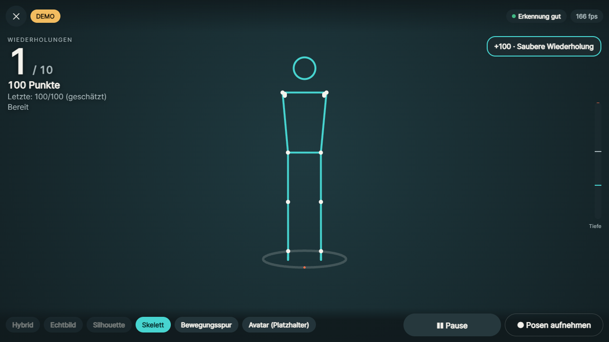<br/>
<sub>Training im Querformat (Tablet, Laptop, TV-nah): HUD links, Rückmeldung rechts, Bedienleiste in einer Zeile.</sub></p>

### Konzeptbilder aus der Produktkonzeption

Visuelle Richtung für spätere Phasen – **keine** verwendbaren 3D-Modelle oder fertige UI
([docs/references/](docs/references/)).

<table>
<tr>
<td align="center" valign="top" width="33%">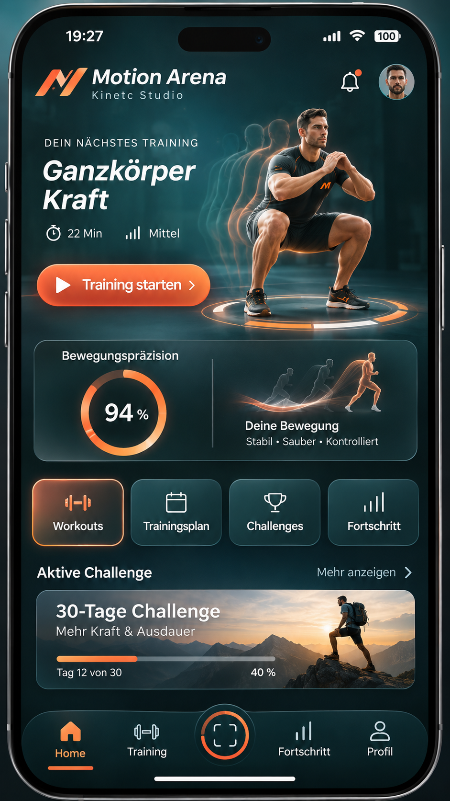<br/><b>Mobile – Kinetic Studio</b><br/><sub>Zielbild der Smartphone-Startseite</sub></td>
<td align="center" valign="top" width="33%">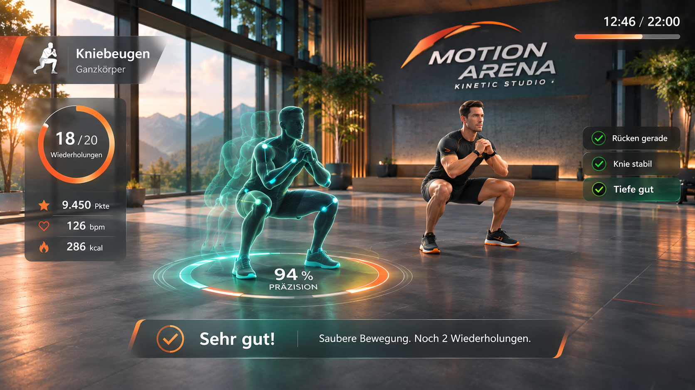<br/><b>TV-Modus</b><br/><sub>Umgesetzt als 1:1-Spiegelung der App</sub></td>
<td align="center" valign="top" width="33%">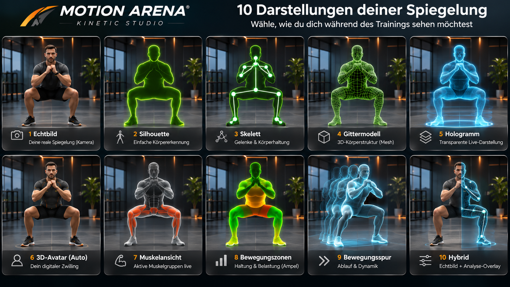<br/><b>10 Spiegelungsmodi</b><br/><sub>Alle 10 umgesetzt</sub></td>
</tr>
<tr>
<td align="center" valign="top" width="33%"><br/><b>15 Avatare</b><br/><sub>Umgesetzt als stilisierte 2D-Figuren</sub></td>
<td align="center" valign="top" width="33%"><br/><b>20 Trainingsräume</b><br/><sub>Umgesetzt als gezeichnete Räume mit Lichtreaktion</sub></td>
<td align="center" valign="top" width="33%"><br/><b>Live Body Load</b><br/><sub>Umgesetzt als Live-Körperanalyse</sub></td>
</tr>
</table>

---

## Auf dem Fernseher anzeigen

Der Fernseher zeigt dasselbe wie die App am Handy – nur groß. Am Fernseher wird nichts installiert, nur ein Browser
gebraucht (Smart-TV-Browser, Fire TV/Android TV mit Browser, Laptop am HDMI-Eingang …).

1. Am Fernseher **[youra82.github.io/motion_arena/?tv](https://youra82.github.io/motion_arena/?tv)** öffnen – oder in der
   App „Dieses Gerät ist der Fernseher“ wählen. Es erscheinen ein QR-Code und ein 6-stelliger Code.
2. Mit dem Handy den **QR-Code scannen** → Motion Arena öffnet sich und koppelt sofort.
   Alternativ in der App auf der Startseite unter „Auf dem Fernseher anzeigen“ den **Code eintippen** – dann am
   Fernseher **„Annehmen“** drücken (Fernbedienung: der Knopf ist schon ausgewählt).
3. Einmalig fragt das Handy, ob das **Bild 1:1** gespiegelt werden darf (mit Kamerabild in Echtbild/Hybrid).
   Ohne Zustimmung zeigt der Fernseher die Figur aus den Körperpunkten im gewählten Raum – ohne Kamerabild.
4. Training oder Analyse am Handy starten – der Fernseher zeigt Zähler, Punkte, Hinweise, Analyse und Ergebnis.
   Im Live-Bild am Handy zeigt **„📺 TV: Bild/Figur“**, dass gerade gesendet wird. „Trennen“ beendet die Kopplung.

Tipps: Handy im **Querformat** aufstellen, damit das Bild den Fernseher füllt. Handy und Fernseher sollten im selben
WLAN sein. Es kann immer nur **ein** Handy mit einem Fernseher verbunden sein; unbenutzte Codes werden nach 10 Minuten
erneuert.

---

## Installation

Der **PC** (Windows, macOS oder Linux) betreibt die App, das **Handy** öffnet sie im Browser und nutzt seine Kamera.
Beide müssen im selben WLAN sein. Ohne Handy lässt sich alles auch am PC mit Webcam oder im Demo-Modus ausprobieren.

### Auf dem Handy installieren (ohne PC) – am einfachsten

Die App ist auf **GitHub Pages** veröffentlicht: <https://youra82.github.io/motion_arena/>.
Sie ist eine reine Web-App – der Server liefert nur die Dateien aus; **Kamera, Erkennung und Bewertung laufen
ausschließlich auf dem Handy**.

**Schritt 1 – QR-Code scannen.** Die Kamera-App des Handys öffnen, auf den QR-Code richten und den angezeigten Link
antippen (oder <https://youra82.github.io/motion_arena/?install=1> eintippen).

<p align="center"></p>

**Schritt 2 – „Als App installieren“.** Oben auf der Seite erscheint eine hervorgehobene Karte:

<table>
<tr>
<td align="center" valign="top" width="50%"><br/>
<b>Android</b> (Chrome, Edge, Samsung Internet)<br/><sub><b>„📲 Jetzt installieren“</b> tippen → im Dialog des Browsers <b>„Installieren“</b> bestätigen.</sub></td>
<td align="center" valign="top" width="50%"><br/>
<b>iPhone</b> (Safari)<br/><sub>Unten auf <b>Teilen</b> → <b>„Zum Home-Bildschirm“</b> → oben rechts <b>„Hinzufügen“</b>.</sub></td>
</tr>
</table>

**Schritt 3 – App starten.** **Motion Arena** liegt jetzt auf dem Startbildschirm. Öffnen, **„▶ Training starten“**
tippen und den **Kamerazugriff erlauben**. Danach führt die App durch Kalibrierung und Countdown
(siehe [Galerie](#galerie)).

Beim ersten Öffnen speichert die App sich selbst, die Erkennung und das schnelle Modell (~16 MB) auf dem Handy –
danach funktioniert sie **ohne Internet**. Updates kommen automatisch beim nächsten Öffnen mit Internet.
Jeder Push auf `main` baut, prüft und veröffentlicht die App neu
([`.github/workflows/pages.yml`](.github/workflows/pages.yml)).

> Ein Browser darf eine Web-App nie ohne Zustimmung installieren – ein Tipp bzw. die drei Schritte auf dem iPhone
> sind das Minimum. Die Installation braucht eine Adresse mit echtem HTTPS-Zertifikat; deshalb klappt sie über
> GitHub Pages, aber nicht über den selbstsignierten Heimnetz-Server unten.
>
> *Zu den Bildern:* Die Karten oben sind echte Aufnahmen der App im Handyformat. Den Installationsdialog von Android,
> das Teilen-Menü des iPhones und die Kamera-Freigabe zeigt das Betriebssystem selbst – sie sind hier nicht
> abgebildet, weil sie sich nur auf echten Geräten aufnehmen lassen.

### Automatische Installation am PC (Windows)

Nur nötig, wenn die App **vom eigenen PC** laufen soll – z. B. ohne Internet im Heimnetz, zum Entwickeln oder für
die Browsertests. Wie bei einem Spiel: einmal doppelklicken, alles andere passiert von selbst.
**Keine Administratorrechte nötig.**

**Schritt 1 – Projekt herunterladen.** Auf der GitHub-Seite oben rechts **„Code“** → **„Download ZIP“** und die
ZIP-Datei entpacken (Rechtsklick → *Alle extrahieren*). Alternativ `git clone https://github.com/Youra82/motion_arena.git`.

<p align="center">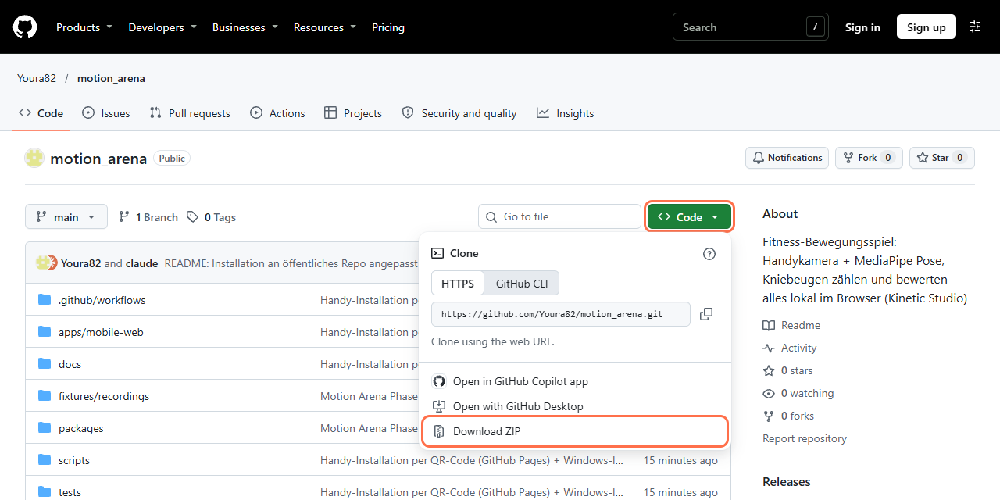</p>

**Schritt 2 – `Installieren.bat` doppelklicken.** Im entpackten Ordner `motion_arena-main` die Datei
**`Installieren.bat`** doppelklicken. Erscheint *„Der Computer wurde durch Windows geschützt“* (SmartScreen bei aus dem
Internet geladenen Dateien): *Weitere Informationen → Trotzdem ausführen*. Ein Fenster öffnet sich und arbeitet sechs
Schritte ab:

1. **Node.js prüfen** – fehlt es, wird eine eigene Kopie von nodejs.org geladen, die **SHA-256-Prüfsumme** kontrolliert
   und nur für Motion Arena unter `%LOCALAPPDATA%\MotionArena\tools` abgelegt (keine Systemänderung).
2. **pnpm einrichten.**
3. **Abhängigkeiten installieren** (beim ersten Mal 1–3 Minuten).
4. **App bauen** und Erkennungsmodelle laden.
5. **Firewall-Frage:** `J` + Enter richtet die Freigabe fürs Handy im Heimnetz ein (Windows fragt dann einmal nach
   Administratorrechten), `n` überspringt sie. Wer nur den QR-Code zur installierbaren App nutzt, braucht sie nicht.
6. **Desktop-Verknüpfung „Motion Arena“** anlegen.

<table>
<tr>
<td align="center" valign="top" width="50%">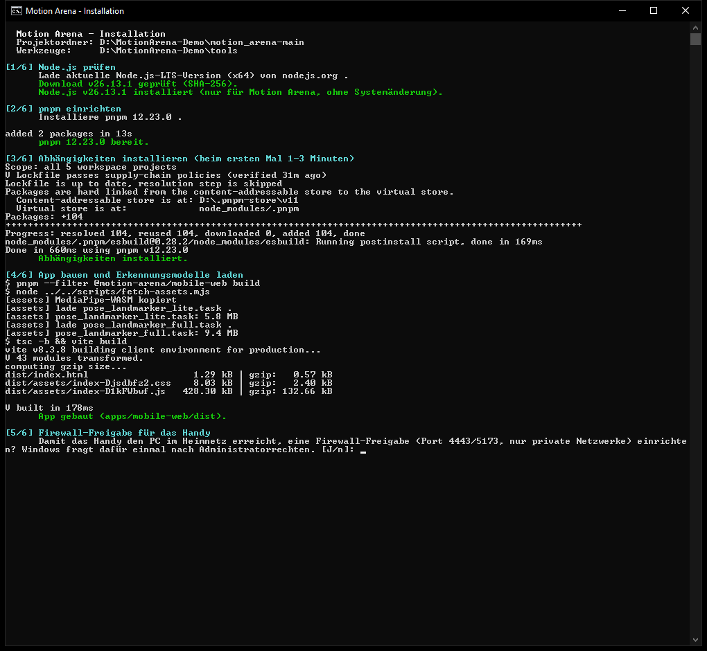<br/>
<sub>Schritte 1–4 erledigt, das Fenster wartet auf die Antwort zur Firewall-Freigabe.</sub></td>
<td align="center" valign="top" width="50%">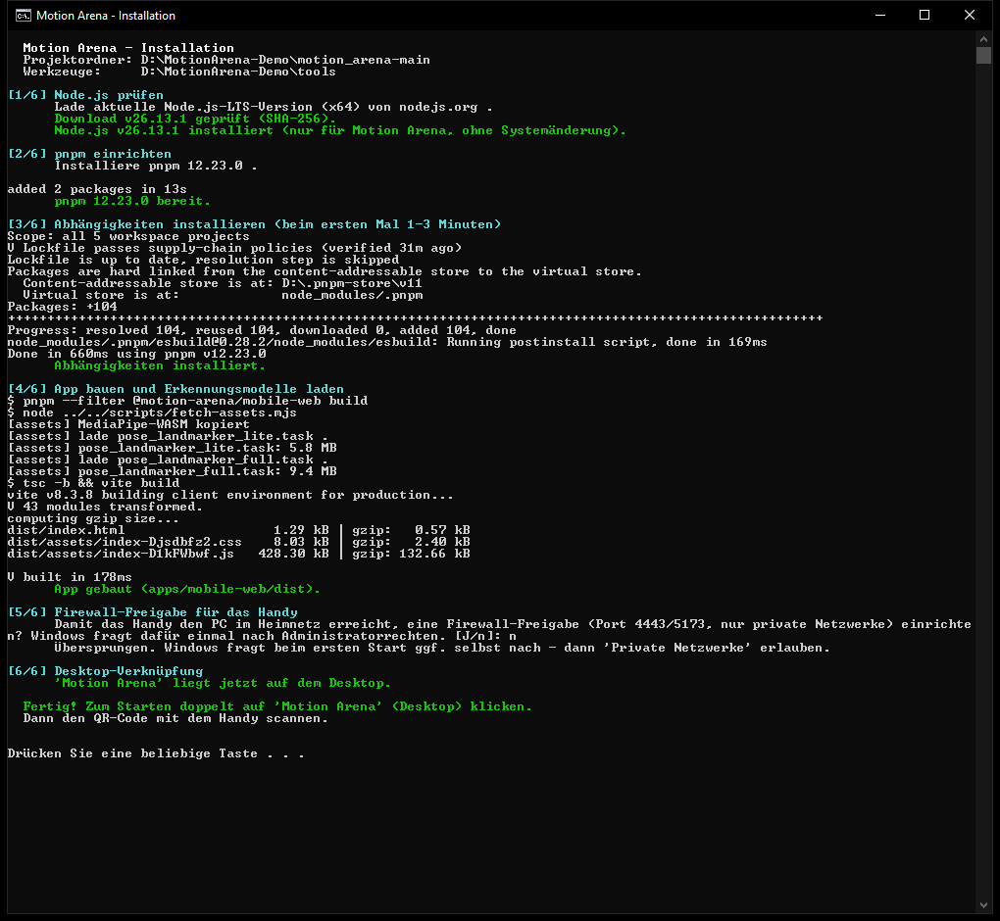<br/>
<sub>Fertig – beliebige Taste schließt das Fenster.</sub></td>
</tr>
</table>

**Schritt 3 – „Motion Arena“ auf dem Desktop doppelklicken.** Das Fenster zeigt den **QR-Code** – mit dem Handy
scannen und wie [oben](#auf-dem-handy-installieren-ohne-pc--am-einfachsten) installieren. Zusätzlich öffnet sich im
Browser die Verbindungsseite: links der **empfohlene QR-Code** zur installierbaren App, daneben die Adressen im
Heimnetz (laufen über diesen PC, mit Zertifikatswarnung, ohne echte Installation). Das schwarze Fenster offen lassen,
solange die Heimnetz-Adressen genutzt werden; Schließen beendet sie.

<table>
<tr>
<td align="center" valign="top" width="45%">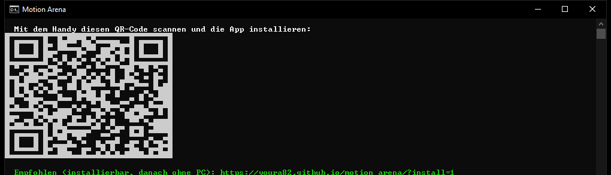<br/>
<sub>Startfenster mit QR-Code (Ausschnitt; die Zeilen mit den Heimnetz-Adressen sind abgeschnitten).</sub></td>
<td align="center" valign="top" width="55%">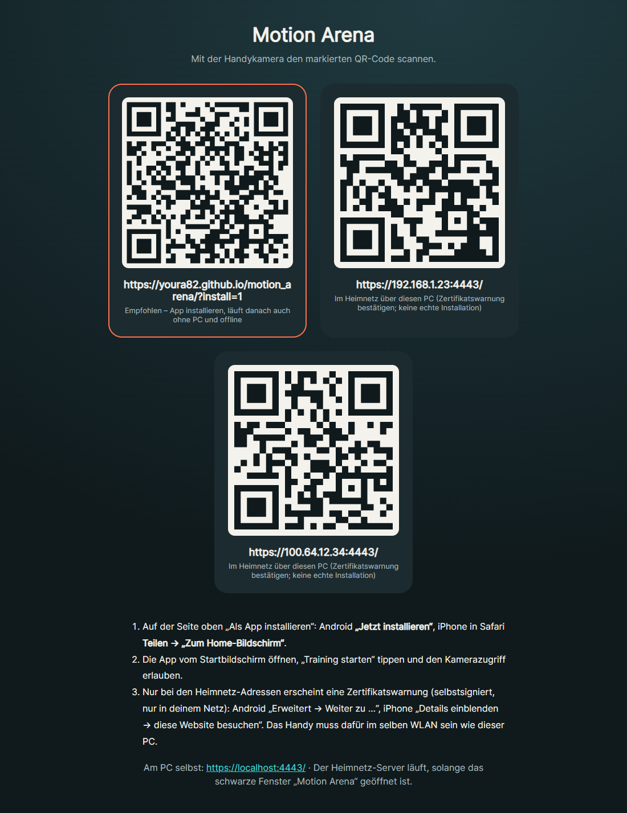<br/>
<sub>Verbindungsseite im Browser (Heimnetz-Adressen hier Beispiele).</sub></td>
</tr>
</table>

| Datei | Zweck |
| --- | --- |
| `Installieren.bat` | installiert alles; **erneut ausführen = aktualisieren** (z. B. nach neuem Download) |
| `Motion Arena starten.bat` | dasselbe wie die Desktop-Verknüpfung |
| `Deinstallieren.bat` | entfernt Verknüpfung, heruntergeladene Werkzeuge und Firewall-Freigabe; danach den Projektordner löschen |

Die Skripte liegen offen lesbar in [`scripts/windows/`](scripts/windows/).

<sub>Die Fensterbilder stammen aus einem echten Lauf von `Installieren.bat` in einem frisch entpackten ZIP
(Ordner `D:\MotionArena-Demo`); bei dir stehen dort deine Pfade. SmartScreen- und Administrator-Abfrage zeigt Windows
selbst – sie sind nicht abgebildet.</sub>

Die folgenden Schritte beschreiben die **manuelle Installation** – für macOS/Linux oder wenn du jeden Schritt selbst
steuern willst.

### 1. Voraussetzungen

| Was | Wofür | Prüfen |
| --- | --- | --- |
| **Node.js ≥ 22** (LTS) | baut und startet die App | `node -v` |
| **pnpm** | Paketverwaltung des Projekts | `pnpm -v` |
| **Git** | Projekt herunterladen | `git --version` |
| **Internet beim ersten Start** | lädt einmalig die Pose-Modelle (~15 MB) | – |
| **Google Chrome** (nur für `pnpm e2e` / `pnpm screenshots`) | automatische Browsertests | – |
| **Handy** mit aktuellem Chrome (Android) oder Safari (iPhone) | Kamera und Anzeige | – |

**Windows (mit Administratorrechten)** – in PowerShell:

```powershell
winget install OpenJS.NodeJS.LTS
winget install Git.Git
# PowerShell neu öffnen, dann:
node -v                 # muss v22 oder neuer zeigen
npm install -g pnpm
pnpm -v
```

**Windows ohne Administratorrechte** – portable Node.js:

1. Auf [nodejs.org/download](https://nodejs.org/en/download) die **Windows-Binary (.zip, x64)** der LTS-Version laden.
2. Entpacken, z. B. nach `D:\tools\node` (der Ordner muss `node.exe` direkt enthalten).
3. In PowerShell für die aktuelle Sitzung in den Pfad nehmen und pnpm in denselben Ordner installieren:

   ```powershell
   $env:PATH = "D:\tools\node;$env:PATH"
   npm install -g pnpm --prefix D:\tools\node
   pnpm -v
   ```

   Dauerhaft: *Systemsteuerung → System → Erweiterte Systemeinstellungen → Umgebungsvariablen →* `Path` des
   Benutzers um `D:\tools\node` ergänzen.

**macOS / Linux:** Node.js per Paketmanager (`brew install node`) oder [nvm](https://github.com/nvm-sh/nvm)
installieren, dann `npm install -g pnpm`.

### 2. Projekt herunterladen und einrichten

Das Repository ist öffentlich – zum Herunterladen ist keine Anmeldung nötig. Ohne Git geht es auch über
*Code → Download ZIP* auf der GitHub-Seite.

```bash
git clone https://github.com/Youra82/motion_arena.git
cd motion_arena
pnpm install
```

`pnpm install` lädt alle Abhängigkeiten. Das nötige Build-Skript von `esbuild` ist in
[`pnpm-workspace.yaml`](pnpm-workspace.yaml) bereits freigegeben, es ist keine Rückfrage nötig.

### 3a. Am PC ausprobieren

```bash
pnpm dev
```

`http://localhost:5173` im Browser öffnen. Beim **ersten** Start erscheint `[assets] lade pose_landmarker_… .task`:
[`scripts/fetch-assets.mjs`](scripts/fetch-assets.mjs) lädt die Pose-Modelle (lite 5,8 MB, full 9,4 MB) einmalig nach
`apps/mobile-web/public/models/` und kopiert die MediaPipe-WASM-Dateien. Danach wird **nichts mehr von fremden Servern
geladen**. Auf `localhost` erlauben Browser die Webcam auch ohne HTTPS. Ohne Kamera: **„Demo ohne Kamera ansehen“**.

### 3b. Am Handy nutzen

Browser geben die Kamera nur über **HTTPS** frei (Ausnahme `localhost`). `dev:phone` startet deshalb einen
HTTPS-Server mit selbstsigniertem Zertifikat, der im Heimnetz erreichbar ist.

1. **PC und Handy ins selbe WLAN** bringen (kein Gast-WLAN – dort sind Geräte oft voneinander abgeschirmt).
2. Am PC starten:

   ```bash
   pnpm dev:phone
   ```

3. Die Ausgabe listet unter **`Network:`** alle Adressen des PCs. Die aus deinem WLAN nehmen, meist
   `https://192.168.x.x:5173`. (Eine VPN-Adresse wie Tailscale `100.x.x.x` funktioniert ebenfalls, wenn das Handy im
   selben VPN ist.)
4. **Windows-Firewall:** Beim ersten Start fragt Windows, ob Node.js im Netzwerk kommunizieren darf → für
   **private Netzwerke erlauben**. Kam keine Abfrage und das Handy erreicht den PC nicht, einmalig in einer
   PowerShell **als Administrator**:

   ```powershell
   New-NetFirewallRule -DisplayName "Motion Arena" -Direction Inbound -Protocol TCP -LocalPort 5173,4443 -Action Allow -Profile Private
   ```

5. Am Handy die Adresse öffnen. Die **Zertifikatswarnung ist erwartet** (selbstsigniert, nur in deinem Netz):
   - Chrome (Android): *Erweitert → Weiter zu … (unsicher)*
   - Safari (iPhone): *Details einblenden → diese Website besuchen → Website besuchen*

   <table>
   <tr>
   <td align="center" valign="top" width="50%">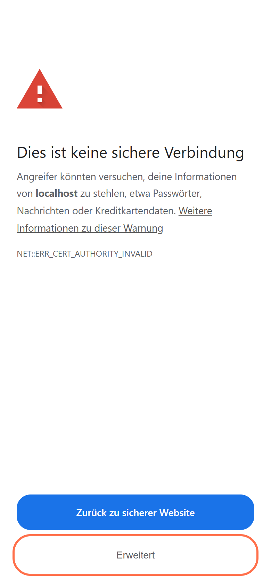<br/><sub>① <b>„Erweitert“</b> tippen</sub></td>
   <td align="center" valign="top" width="50%">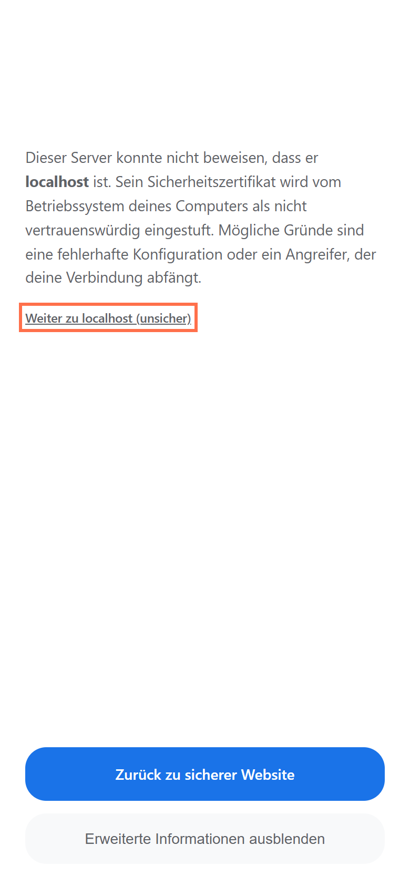<br/><sub>② <b>„Weiter zu … (unsicher)“</b> tippen</sub></td>
   </tr>
   </table>
   <sub>Echte Chrome-Warnseite im Handyformat; auf dem Handy steht statt „localhost“ die Adresse deines PCs.</sub>
6. **„▶ Training starten“** tippen und den **Kamerazugriff erlauben**.
7. **Optional als App auf den Startbildschirm** (die App bringt Manifest und Icon mit):
   - Android/Chrome: Menü *⋮ → App installieren* bzw. *Zum Startbildschirm hinzufügen*
   - iPhone/Safari: *Teilen → Zum Home-Bildschirm*

   Mit dem selbstsignierten Zertifikat bieten manche Browser nur eine Verknüpfung statt einer vollständigen
   Installation an; die Funktion ist dieselbe.

**Aufstellen:** Handy etwa auf Hüfthöhe, **2–3 m Abstand**, ganzer Körper von Kopf bis Fuß im Bild, gutes Licht von
vorne. **Leicht schräg oder seitlich** zur Kamera ist am genauesten.

### 3c. Dauerhaft betreiben (ohne Entwicklungsmodus)

```bash
pnpm start:phone     # baut die App und liefert sie per HTTPS aus: https://<IP-des-PCs>:4443
```

Das ist die schnelle, optimierte Fassung ohne Entwicklerwerkzeuge – geeignet, wenn die App z. B. auf einem Mini-PC
im Heimnetz dauerhaft laufen soll. Alternativ ist `apps/mobile-web/dist/` nach `pnpm build` eine **rein statische
Website** und kann auf jeden Webserver mit **HTTPS** gelegt werden (`.wasm` muss als `application/wasm` ausgeliefert
werden; die Content-Security-Policy steckt bereits in der `index.html`).

### 4. Prüfen, ob alles funktioniert

```bash
pnpm test                # Unit-Tests (Node, ohne Browser)
pnpm typecheck           # TypeScript-Prüfung
pnpm build && pnpm e2e   # Browsertests mit installiertem Chrome
```

### Alle Befehle

| Befehl | Zweck |
| --- | --- |
| `pnpm dev` | Entwicklungsserver, `http://localhost:5173` |
| `pnpm dev:phone` | Entwicklungsserver per HTTPS im Heimnetz, Port 5173 |
| `pnpm start:phone` | Produktions-Build per HTTPS im Heimnetz, Port 4443 |
| `pnpm build` | Produktions-Build nach `apps/mobile-web/dist` |
| `pnpm test` | Vitest: Pose-Engine, Zähler, Bewertung, Session, Engine, echte Aufnahmen |
| `pnpm typecheck` | strikte TypeScript-Prüfung aller Pakete |
| `pnpm e2e` | Playwright-Browsertests (installiertes Chrome; vorher `pnpm build`) |
| `pnpm screenshots` | erzeugt die Galerie-Bilder neu nach `docs/screenshots/` (vorher `pnpm build`) |
| `pnpm icons` | erzeugt die App-Icons neu aus dem Logo |
| `pnpm qr` | erzeugt den QR-Code `docs/qr-handy.png` zur veröffentlichten App |

### Fehlerbehebung

| Problem | Ursache und Lösung |
| --- | --- |
| „Kamera nur über HTTPS oder localhost verfügbar“ | Seite über `http://` oder IP ohne HTTPS geöffnet → `pnpm dev:phone` starten und die `https://`-Adresse nutzen |
| „Kein Kamerazugriff“ | Berechtigung abgelehnt → im Browser bei der Seite (Schloss-/Info-Symbol) Kamera erlauben; iPhone zusätzlich *Einstellungen → Safari → Kamera* |
| „Kamera wird von einer anderen App benutzt“ | Videokonferenz- oder Kamera-App schließen, dann „Erneut versuchen“ |
| Handy erreicht den PC nicht | Selbes WLAN? Kein Gast-WLAN? Richtige `Network`-Adresse mit `https://` und Port? Firewall-Regel aus Schritt 3b |
| „Pose-Modell konnte nicht geladen werden“ | Beim ersten Start fehlte Internet → `apps/mobile-web/public/models/` löschen und `pnpm dev` erneut starten |
| `pnpm` bzw. `node` wird nicht gefunden | PowerShell neu öffnen; bei portabler Version `$env:PATH` wie in Schritt 1 setzen |
| Port 5173 belegt | anderes Programm beenden oder `pnpm --filter @motion-arena/mobile-web exec vite --port 5174` |
| Ständig „Keine Person“ / „Teilkörper“ | weiter weg (2–3 m), Kopf bis Füße im Bild, mehr Licht, ruhiger Hintergrund |
| Ruckelt (niedrige fps) | Profil: Modell **„Schnell (lite)“**; Ansicht **Skelett** statt Silhouette oder Hologramm |
| Fernseher koppelt nicht | Beide Geräte im selben WLAN? Gast-WLAN/„Client-Isolation“ verhindert die Direktverbindung (es gibt bewusst keinen Umweg über fremde Server). Am TV „Neuer Code“, am Handy „Trennen“ und erneut scannen |
| „Der Fernseher ist schon mit einem anderen Handy verbunden“ | Am anderen Handy „Trennen“ oder am TV „TV-Modus beenden“ und neu öffnen |
| `pnpm e2e` findet keinen Browser | Google Chrome installieren (die Tests nutzen das installierte Chrome) |

---

## So funktioniert die Erkennung

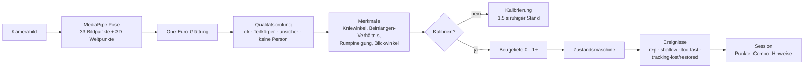

### Beugetiefe

Die normierte **Tiefe** (0 = Stand, ≈ 1 = Oberschenkel waagerecht) kombiniert zwei Signale, die beide unabhängig vom
Abstand zur Kamera und von einer gekippten oder gerollten Kamera sind:

1. **Kniewinkel** – bevorzugt aus den 3D-Weltkoordinaten von MediaPipe (blickwinkelunabhängig), sonst aus der Bildebene.
2. **Beinlängen-Verhältnis** – gerader Abstand Hüfte→Knöchel geteilt durch eine Länge, die sich beim Beugen nicht
   ändert (3D: Oberschenkel + Schienbein; 2D seitlich: dieselben Segmente im Bild; 2D frontal: Schulterbreite).

Gewertet wird nur mit **derselben Messquelle wie bei der Kalibrierung** (3D oder 2D). Wechselt sie mitten im Versuch
oder ändert sich bei reiner 2D-Messung der Blickwinkel, pausiert die Wertung – ohne Strafe.

### Zustandsmaschine

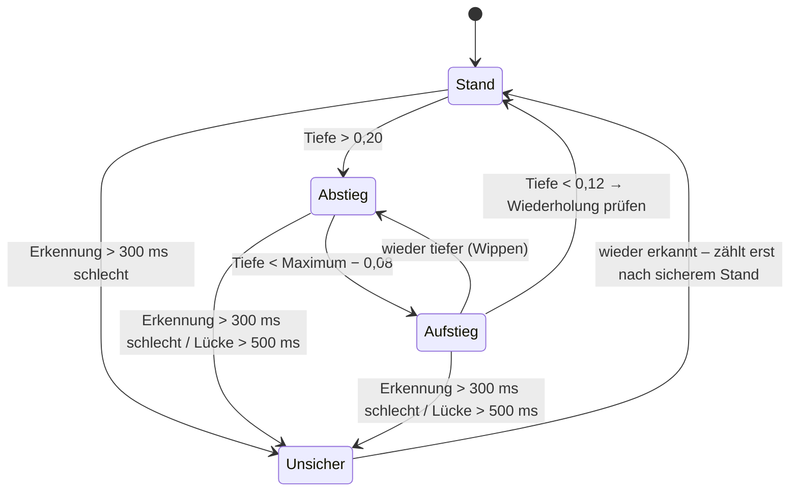

Eine Wiederholung **zählt**, wenn beim Wiederaufrichten gilt:

| Regel | Wert | sonst |
| --- | --- | --- |
| Maximale Tiefe | ≥ 0,50 (≈ Kniewinkel 125–130°) | „zu flach“ (Feedback ab Tiefe 0,30) |
| Dauer | ≥ 600 ms | „zu schnell“ |
| Abtastung | ≥ 4 Bilder, keine Lücke > 350 ms im Versuch | still verworfen (Messproblem, kein Nutzerfehler) |
| Plausibilität | Tiefenänderung ≤ 6 pro Sekunde (+0,15) | Einzelausreißer ignoriert; zwei konsistente Bilder gelten |

Zusätzlich abgefangen: doppelte oder rückwärts laufende Zeitstempel, nicht endliche Werte (NaN/Infinity), weniger als
33 Punkte, Pause/Fortsetzen mitten im Versuch, Start in der Hocke.

Alle Schwellen stehen in [`DEFAULT_SQUAT_OPTIONS`](packages/motion-scoring/src/squat.ts) und sind **Annahmen**, die mit
echten Aufnahmen noch abgestimmt werden müssen.

---

## Bewertung und Punkte

Jede gezählte Wiederholung erhält einen **schematischen** Wert von 0–100, normiert über die bewertbaren Teile:

| Teil | Max. | Volle Punkte bei | Hinweis bei Abweichung |
| --- | --- | --- | --- |
| Tiefe | 50 | Tiefe ≥ 0,85 | „Etwas tiefer gehen“ |
| Kontrolle | 25 | Absenken ≥ 0,8 s | „Langsamer absenken“ |
| Symmetrie | 15 | Links/Rechts-Unterschied ≤ 8° | „Beide Beine gleichmäßiger beugen“ |
| Haltung | 10 | Rumpfneigung ≤ 45° (nur seitlich/schräg) | „Oberkörper aufrechter halten“ |

Nicht bewertbare Teile (z. B. Haltung bei Frontalansicht) werden weggelassen statt geraten.
**Combo:** Wiederholungen mit Wert ≥ 70 verlängern die Serie, jede Stufe gibt +10 % Punkte (maximal +50 %).
Fehlversuche beenden die Combo ohne Punktabzug, Erkennungsprobleme beenden sie nicht.

---

## Architektur

pnpm-Monorepo, TypeScript strikt, **Logik und Darstellung strikt getrennt**: Die Pakete sind reine Funktionen ohne
Browserabhängigkeit und vollständig in Node testbar; die App verbindet sie nur.

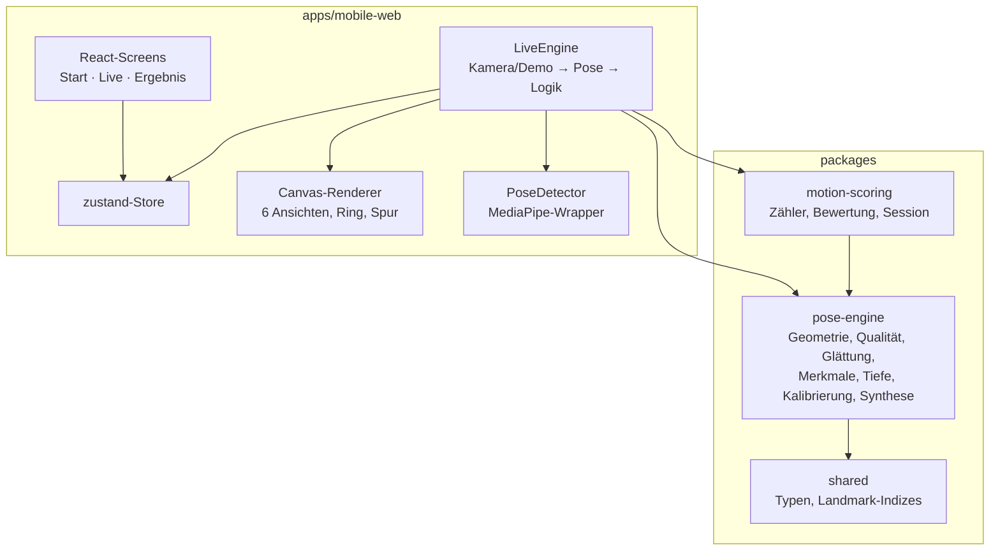

```
motion_arena/
├── apps/mobile-web/          React/Vite-App
│   ├── src/engine/           LiveEngine, MediaPipe-Wrapper, Demo-Quelle, Posen-Recorder
│   ├── src/render/           Canvas-Darstellung (Skelett, Silhouette, Avatar, Spur, Präzisionsring)
│   ├── src/screens/          Start, Live, Ergebnis
│   ├── src/store.ts          App-Zustand (Session unabhängig von der Ansicht)
│   └── vite.config.ts        inkl. Content-Security-Policy
├── packages/
│   ├── shared/               Typen, MediaPipe-Indizes, Skelettkanten
│   ├── pose-engine/          Geometrie, Qualität, One-Euro-Filter, Merkmale, Kalibrierung, synthetische Posen
│   └── motion-scoring/       Kniebeugen-Zustandsmaschine, Bewertung, Session-Reducer
├── tests/e2e/                Playwright-Browsertests
├── fixtures/recordings/      echte Landmark-Aufnahmen als Regressionstests
├── scripts/fetch-assets.mjs  lädt Modelle/WASM einmalig lokal
└── docs/                     Konzept, Status, Codex-Prüfberichte, Referenzbilder, Screenshots
```

**Technik:** React 19, Vite 8, TypeScript 5.9, zustand 5, `@mediapipe/tasks-vision` 1.2, Vitest 3, Playwright.

---

## Datenschutz

- Kamerabilder werden **im Browser auf dem Gerät** verarbeitet und nicht gespeichert. Ohne TV-Kopplung verlässt nichts
  das Gerät (Browsertest mit Netzwerkmitschnitt).
- **Trainingsverlauf und Einstellungen** liegen nur im Speicher des Browsers (localStorage) und werden nie gesendet;
  im Profil löschbar.
- **TV-Kopplung (nur wenn du sie startest):** Zum Finden der Geräte werden der Vermittlungsdienst `0.peerjs.com` und
  ein STUN-Server von Google (`stun.l.google.com`, nennt jedem Gerät seine Netzadresse) kontaktiert. Danach gehen
  Körperpunkte und Live-Werte – und **nur mit Zustimmung** das Live-Bild – verschlüsselt (WebRTC) **direkt** vom Handy
  zum Fernseher; Relay-Server (TURN) sind bewusst nicht eingerichtet. Der QR-Code enthält einen geheimen Schlüssel,
  ein eingetippter Code muss am Fernseher bestätigt werden, weitere Handys werden abgewiesen. Alle Nachrichten werden
  am Fernseher streng geprüft. Ein Widerruf der Bildfreigabe beendet den Videostream sofort.
- Modelle und WASM werden vom eigenen Server ausgeliefert, nicht von einem CDN. Auf GitHub Pages liefert GitHub
  nur die statischen Dateien aus – es gibt kein Backend, keine Anmeldung, keine Analyse-Tools.
- Nach der Installation hält ein Service Worker App und Modell auf dem Gerät vor; es werden dabei nur die
  App-Dateien selbst gespeichert, keine Kamerabilder oder Ergebnisse.
- **MediaPipe-Telemetrie blockiert:** `@mediapipe/tasks-vision` 1.2.3 versucht beim Schließen, Nutzungsmetriken an
  `odml.pa.googleapis.com` zu senden. Eine **Content-Security-Policy** ([`vite.config.ts`](apps/mobile-web/vite.config.ts))
  erlaubt nur Verbindungen zum eigenen Server und blockiert das. Ein Browsertest zeichnet den gesamten Netzwerkverkehr
  auf (Start, Silhouette, Beenden) und schlägt fehl, sobald eine Anfrage das Gerät verlassen würde.
- „Posen aufnehmen“ speichert nur Gelenkkoordinaten als Datei-Download auf dem Gerät.

---

## Tests

```bash
pnpm test        # 242 Tests
pnpm build && pnpm e2e   # 34 Browsertests
```

| Ebene | Inhalt |
| --- | --- |
| **Pose-Engine** | Winkel 2D/3D und Seitenverhältnis, Qualitätsstufen, ungültige Werte, Glättung, Kalibrierung (Stand, Hocke, Lücken, seitliches Wandern), Tiefe frontal/seitlich, gerollte Kamera |
| **Zähler** | Definition of Done „3 saubere Kniebeugen = 3“ in 5 Kamera-Varianten und mit 20 Rausch-Seeds; Wippen, Zittern, zu flach/schnell/langsam/tief, Teilkörper, Verschwinden in der Hocke, Abstandsänderung, Drehung, Zeitstempel-Fehler, Lücken, Ausreißer, Messquellenwechsel |
| **Session** | Punkte, Combo, Fehlversuche, Erkennungsaussetzer ohne Strafe, Pause ohne Zeitzählung |
| **Engine** | Abbruch während Kamera-/Modellladen, React-StrictMode-Doppelstart, Fehler im Lauf, Masken-Umschaltung, GPU→CPU, Pause zwischen zwei Bildern, Ziel-Timer (MediaPipe-Attrappe) |
| **Fortschritt & Speicher** | Kalendertage, Sommerzeit, Wochenbeginn Montag, Challenge-Abschnitte, Zukunftsdaten, beschädigte/manipulierte/doppelte Einträge, Speicher voll oder gesperrt, Aufbewahrungsgrenze |
| **Körperanalyse** | Bewegungen frontal/seitlich, gekippte Kamera, Gehen, Hinsetzen, Vorbeugen, Armschwingen, Ausreißer, Bildlücken, verdeckte Gelenke, fehlende 3D-Daten, Seitenzuordnung |
| **TV** | Protokollprüfung (Typen, Längen, Grenzen, Version), Sitzungsbindung, Bestätigung, Rennen bei Auf-/Abbau, Aufräumen von Video/Timern, Widerruf auch bei Speicherfehler |
| **Darstellung** | Körpergitter bei degenerierten/seitlichen Posen, 20 Räume, 15 Avatare, Einstellungen |
| **Browser** | Kompletter Demo-Ablauf inkl. Ansichtswechsel ohne Datenverlust; echte MediaPipe-Erkennung mit Chrome-Testkamera und Personenbild (Silhouette, Körperanalyse); verweigerte Kamera; Laden abbrechen; Netzwerk-Nachweis Datenschutz; **Service Worker mit Offline-Start**; Installationskarten; Navigation und Einstellungen; **TV-Kopplung** (QR, Code mit Annehmen/Ablehnen, zweites Handy, gleiche Anzeige, Ergebnis); Avatar & Raum |

Die Bewegungstests nutzen einen **synthetischen Posen-Generator** (`synthPose`, `synthSequence`) mit realistischen
Proportionen, Front- und Seitenansicht, 3D-Weltkoordinaten, Rauschen, Verdeckung und Kameradrehung.

---

## Echte Aufnahmen als Testfälle

Damit Schwellen an echten Bewegungen abgestimmt werden können, lassen sich Live-Sitzungen aufnehmen und dauerhaft als
Tests verwenden:

1. In der App **vor** der Kalibrierung **„● Posen aufnehmen“** tippen.
2. Kalibrieren, dann z. B. genau 5 saubere Kniebeugen (oder bewusst Fehlerfälle: zu flach, Teilkörper …).
3. **„■ Aufnahme“** tippen → JSON-Datei wird auf dem Gerät gespeichert (nur Gelenkkoordinaten).
4. Datei nach [`fixtures/recordings/`](fixtures/recordings/) legen und `"expectedReps": 5` eintragen.
5. `pnpm test` spielt die Aufnahme exakt wie die App ab (Glättung → Kalibrierung → Zähler) und prüft die Anzahl.

---

## Qualitätssicherung mit Codex

Claude Code hat den Code gebaut; OpenAI Codex hat ihn in mehreren Runden unabhängig geprüft und dabei **gegnerische Tests**
geschrieben, die versuchen, die Logik zu brechen. Codex durfte nur neue Testdateien anlegen – die Fehler blieben rot,
bis Claude sie im Quellcode behoben hatte.

| Runde | Befunde | Beispiele | Ergebnis |
| --- | --- | --- | --- |
| [1](docs/reviews/codex-review-1.md) | 18 | Abstandsänderung erfand/verschluckte Wiederholungen; NaN vergiftete Punktestand; Kameralücken zählten als Bewegung; Einzelausreißer erzeugte Fehlversuch | alle behoben |
| [2](docs/reviews/codex-review-2.md) | 12 | MediaPipe-Telemetrie an Google; alte Engine koppelte Video der neuen ab; gerollte Kamera erzeugte Tiefe; 3D-Ausfall wurde „zu flach“; Pause zwischen zwei Bildern | alle behoben |
| [3](docs/reviews/codex-review-3.md) | 15 | Defekter Verlaufseintrag blockierte die Startseite; Löschen meldete Erfolg trotz Fehler; schräge Kamera ergab Einbeinstand; Sitzen galt als Kniebeuge; Unsicherheit wurde als „gering“ angezeigt | alle behoben |
| [4](docs/reviews/codex-review-4.md) | 13 | TV: Bild und Anzeige konnten von verschiedenen Handys stammen; Code ersetzte Bestätigung; kaputte Nachrichten erreichten den TV; Widerruf nach Speicherfehler unwirksam; Videospuren liefen nach Trennen weiter | alle behoben |
| [5](docs/reviews/codex-review-5.md) | 9 | Fehlgeschlagener Widerruf galt nach Neuladen wieder; TV-Zulassung erst beim Öffnen geprüft; Avatar stürzte bei fehlendem Handgelenk ab; TV verlor Vorder-/Rückseite; Vorschau ignorierte „Bewegung reduzieren“ | alle behoben |

Aufträge und Berichte liegen in [`docs/reviews/`](docs/reviews/), die Codex-Tests in `packages/*/test/codex/`,
`apps/mobile-web/src/**/*-r*.test.ts` und `tests/e2e/*-r*.spec.ts`.

---

## Grenzen – was die Kamera nicht kann

- Eine einzelne Kamera misst **keine Muskelkraft, Gelenkbelastung oder Verletzungsrisiko**. Die Bewertung ist eine
  schematische Schätzung und **keine medizinische oder trainerische Beurteilung**.
- Frontal ist der Kniewinkel nur über die geschätzten 3D-Weltkoordinaten bestimmbar; am genauesten ist eine leicht
  schräge oder seitliche Aufstellung.
- Die **Live-Körperanalyse** zeigt eine grobe, modellbasierte **Vermutung**, welche Zonen beansprucht werden – keine
  Messung von Muskelaktivität, Kräften, Gewichtsverteilung oder Verletzungsrisiko.
- **3D-Figuren:** Animiert ist bisher ein Trainer (Lukas, CC0-Grundmodell ausstaffiert); die übrigen 14 Avatare
  gibt es nur als Porträt – fotorealistische riggbare Modelle je Person bräuchten lizenzierte Assets. Einige Raumbilder
  sind aus den Konzeptkarten hochskaliert und etwas weicher; Waterfall Oasis nutzt eine Plattform, weil das Bild im
  Vordergrund nur Wasser zeigt.
- Nur die Übung Kniebeuge wird gezählt und bewertet.
- **TV-Modus ohne Relay:** Lassen Router/Firewall keine direkte Verbindung zu, klappt die Kopplung nicht (kein Umweg
  über fremde Server).
- **Nicht getestet:** echte Person vor echter Kamera, Leistung auf Handys (fps, Wärme, Akku), iOS Safari/Android
  Chrome, echter Fernseher. Details: [docs/STATUS.md](docs/STATUS.md).

---

## Roadmap

| Phase | Inhalt | Stand |
| --- | --- | --- |
| 1 | Smartphone-MVP: Kamera, Pose, Kalibrierung, Kniebeuge, Punkte, Ansichten | **gebaut**, Handytest offen |
| 2 | TV-Modus: Kopplung per QR/Code, gleiche Anzeige, Live-Bild per WebRTC | **gebaut**, Test am echten TV offen |
| 3 | Live Body Load: grobe, relative Beanspruchungszonen mit Konfidenz und Hinweis „geschätzt“ | **gebaut** (Heuristik, synthetisch geprüft) |
| 4 | Inhalte: 20 Trainingsräume, 15 Avatare, 10 Ansichten | **gebaut** als stilisierte 2D-Fassung; 3D-Avatare erst mit lizenzierten Assets |
| 5 | Weitere Übungen (Ausfallschritt, Hampelmann …) mit Zählung und Bewertung; Trainer-Avatar macht vor | geplant |

---

## Projektdokumente

| Dokument | Inhalt |
| --- | --- |
| [docs/STATUS.md](docs/STATUS.md) | Was getestet ist, was nicht, bekannte Grenzen |
| [docs/PROJECT_BRIEF.md](docs/PROJECT_BRIEF.md) | Vision und verbindliche Entscheidungen |
| [docs/FEATURES.md](docs/FEATURES.md) | Trainingsräume, Avatare, Ansichten, Prioritäten |
| [docs/DESIGN_SYSTEM.md](docs/DESIGN_SYSTEM.md) | Kinetic Studio: Farben, Signaturen, UI-Zustände |
| [docs/TECHNICAL_ARCHITECTURE.md](docs/TECHNICAL_ARCHITECTURE.md) | Architekturvorschlag aus der Konzeption |
| [docs/IMPLEMENTATION_PLAN.md](docs/IMPLEMENTATION_PLAN.md) | Phasen und Definition of Done |
| [docs/LIVE_BODY_LOAD.md](docs/LIVE_BODY_LOAD.md) | Anforderungen an den Analysemodus |
| [docs/references/](docs/references/) | Konzeptbilder (nur visuelle Richtung, keine Assets) |

Die Gestaltung ist von der Bewegungsfreude früherer Kamera-Fitnessspiele inspiriert, übernimmt aber keine fremden
Marken, Logos, Layouts oder Assets.
