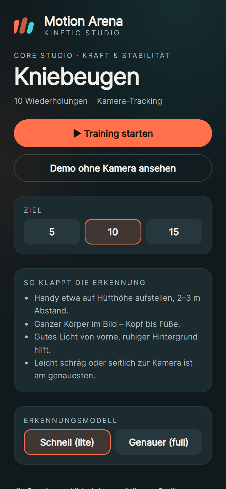
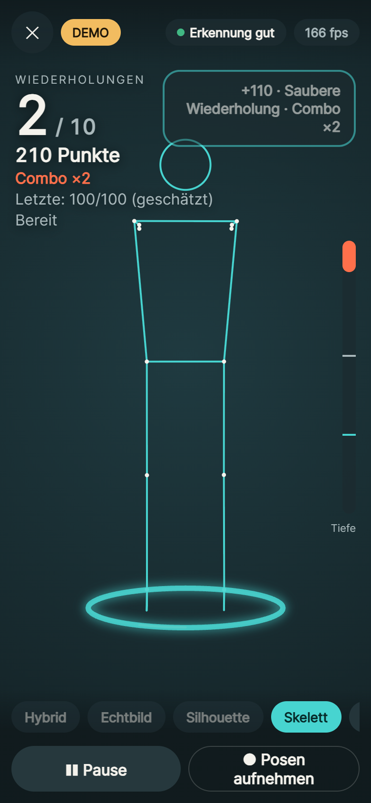
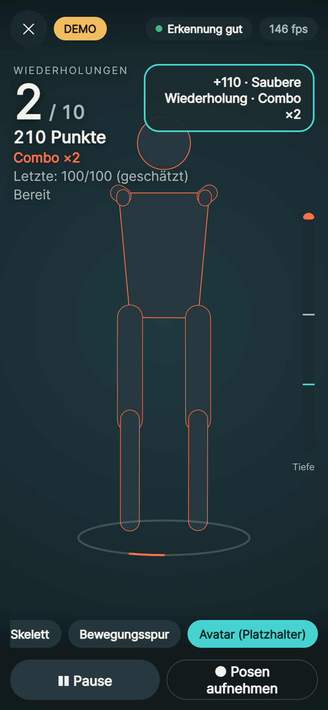
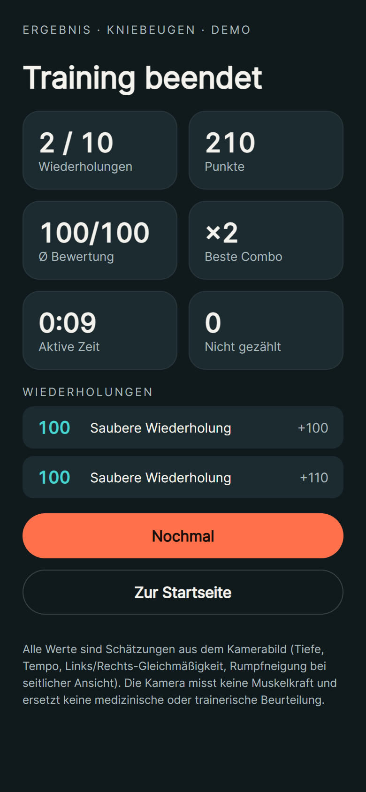
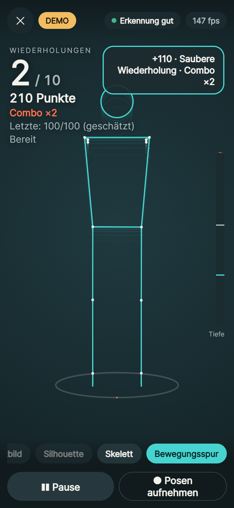
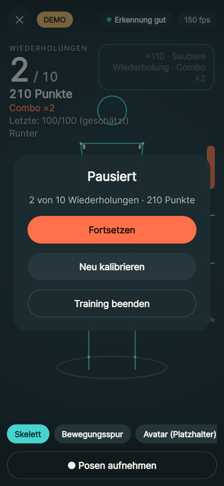
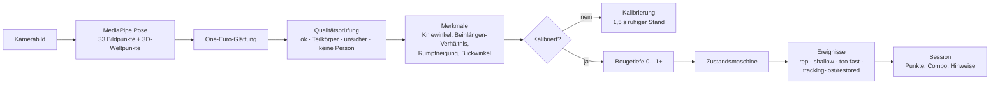
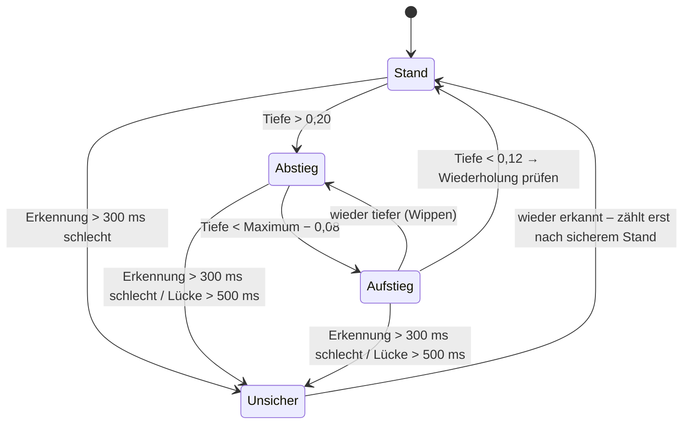
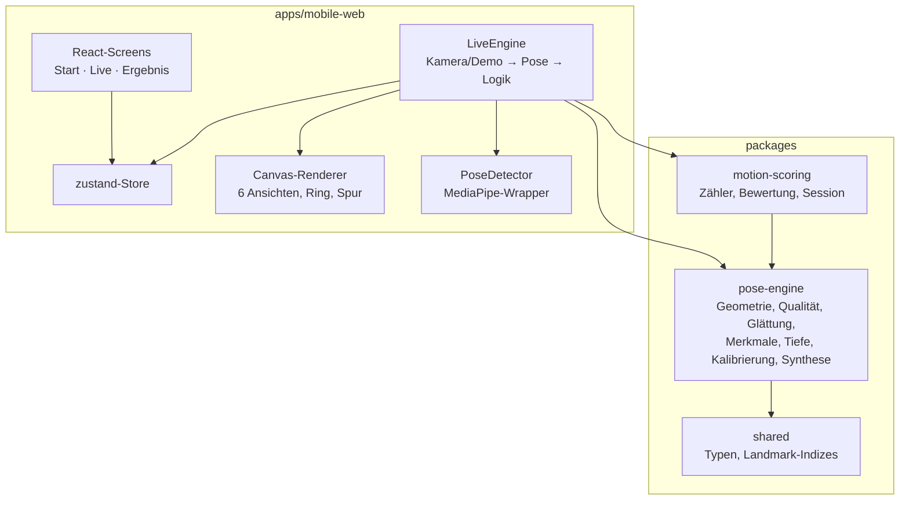

# Motion Arena

**Fitness-Bewegungsspiel für Smartphone und Browser.** Die Kamera erfasst die Person, MediaPipe Pose schätzt die
Körperhaltung, Kniebeugen werden live gezählt, verständlich bewertet und mit Punkten und Combos belohnt.
Alles läuft lokal auf dem Gerät – kein Kamerabild und keine Bewegungsdaten verlassen den Browser.

Designrichtung **Kinetic Studio**: dunkles Petrol/Graphit, warmes Weiß, Korallorange als Akzent, Türkis für die
Körperspiegelung.

> **Stand:** Phase 1 – Smartphone-MVP mit der Übung Kniebeuge. Die Logik ist mit 93 Unit-Tests und 4 Browsertests
> abgesichert und wurde in zwei unabhängigen Prüfrunden (Codex) gehärtet. **Noch nicht erfolgt:** der Test mit einer
> echten Person vor einer echten Handykamera – siehe [Status](docs/STATUS.md).

<p align="center">
  
  
  
  
</p>
<p align="center"><sub>Screenshots aus dem automatischen Browsertest im Demo-Modus (synthetische Bewegung, keine echte Person).</sub></p>

---

## Inhalt

- [Funktionen](#funktionen)
- [Schnellstart](#schnellstart)
- [Auf dem Handy testen](#auf-dem-handy-testen)
- [So funktioniert die Erkennung](#so-funktioniert-die-erkennung)
- [Bewertung und Punkte](#bewertung-und-punkte)
- [Architektur](#architektur)
- [Datenschutz](#datenschutz)
- [Tests](#tests)
- [Echte Aufnahmen als Testfälle](#echte-aufnahmen-als-testfälle)
- [Qualitätssicherung mit Codex](#qualitätssicherung-mit-codex)
- [Grenzen – was die Kamera nicht kann](#grenzen--was-die-kamera-nicht-kann)
- [Roadmap](#roadmap)
- [Projektdokumente](#projektdokumente)

---

## Funktionen

| Bereich | Was die App macht |
| --- | --- |
| **Kamera & Pose** | Frontkamera über `getUserMedia`, MediaPipe Pose Landmarker (Modell *lite* oder *full*, GPU mit automatischem CPU-Rückfall), 33 Körperpunkte plus 3D-Weltkoordinaten |
| **Kalibrierung** | Person steht 1,5 s ruhig und vollständig im Bild (Kopf bis Füße). Erkennt Blickwinkel (frontal/schräg/seitlich) und speichert Referenzwerte. Startet neu bei Bewegung, Lücken oder Hocke |
| **Kniebeugen-Zähler** | Zustandsmaschine mit Hysterese: *Stand → Abstieg → Aufstieg → Stand*. Zählt erst beim Wiederaufrichten, toleriert Wippen am Tiefpunkt, ignoriert Zittern an den Schwellen |
| **Fehlversuche** | „Zu flach“ und „zu schnell“ werden erkannt, nicht gezählt und kurz erklärt |
| **Unsichere Erkennung** | Teilkörper, geringe Konfidenz, Kameralücken, Blickwinkelwechsel → **Warnung statt Wertung**, keine Strafpunkte, Combo bleibt erhalten |
| **Bewertung** | Schematische Punkte 0–100 aus Tiefe, Kontrolle, Links/Rechts-Symmetrie und (nur seitlich) Haltung, jeweils mit Hinweis „geschätzt“ |
| **Spiel** | Punkte, Combo-Bonus bis +50 %, Ziel 5/10/15 Wiederholungen, Countdown, Pause, Ergebnisseite |
| **Ansichten** | Hybrid (Video + Skelett), Echtbild, Silhouette (lokale Personenmaske), Skelett, Bewegungsspur, Avatar (Platzhalter). Wechsel jederzeit ohne Datenverlust |
| **Signaturen** | Präzisionsring am Boden (zeigt die Beugetiefe, leuchtet bei gezählter Wiederholung), Bewegungsspur mit Nachbildern |
| **Demo-Modus** | Synthetische Kniebeugen ohne Kamera, deutlich als **DEMO** gekennzeichnet |
| **Posen-Aufnahme** | Speichert nur Gelenkkoordinaten (keine Bilder) als Datei – für reproduzierbare Tests mit echten Bewegungen |
| **Fehlerzustände** | Kamera verweigert / nicht vorhanden / belegt / getrennt, Modell lädt nicht, kein HTTPS – jeweils mit Ausweg (Erneut, Demo, Zurück); Laden jederzeit abbrechbar |

<p align="center">
  
  
</p>

---

## Schnellstart

Voraussetzungen: **Node.js ≥ 22** und **pnpm** (`npm i -g pnpm`).

```bash
git clone https://github.com/Youra82/motion_arena.git
cd motion_arena
pnpm install
pnpm dev            # http://localhost:5173
```

Beim ersten `dev` bzw. `build` lädt [`scripts/fetch-assets.mjs`](scripts/fetch-assets.mjs) einmalig die Pose-Modelle
von Google (lite 5,8 MB, full 9,4 MB) nach `apps/mobile-web/public/models/` und kopiert die MediaPipe-WASM-Dateien
aus `node_modules`. **Zur Laufzeit wird nichts von fremden Servern geladen.**

Ohne Kamera ausprobieren: auf der Startseite **„Demo ohne Kamera ansehen“**.

| Befehl | Zweck |
| --- | --- |
| `pnpm dev` | Entwicklungsserver (localhost, Kamera erlaubt) |
| `pnpm dev:phone` | HTTPS-Server im LAN für Handytests |
| `pnpm test` | Vitest: Pose-Engine, Zähler, Bewertung, Session, Engine, echte Aufnahmen |
| `pnpm typecheck` | strikte TypeScript-Prüfung aller Pakete |
| `pnpm build` | Produktions-Build nach `apps/mobile-web/dist` |
| `pnpm e2e` | Playwright-Browsertests (nutzt installiertes Chrome; vorher `pnpm build`) |

---

## Auf dem Handy testen

Browser geben die Kamera nur über **HTTPS** oder `localhost` frei.

```bash
pnpm dev:phone      # HTTPS mit selbstsigniertem Zertifikat, im LAN erreichbar
```

1. Am Handy `https://<IP-des-PCs>:5173` öffnen, Zertifikatswarnung bestätigen, Kamera erlauben.
2. Handy etwa auf Hüfthöhe aufstellen, **2–3 m Abstand**, ganzer Körper im Bild.
3. Gutes Licht von vorne; **leicht schräg oder seitlich** zur Kamera ist am genauesten.

---

## So funktioniert die Erkennung



### Beugetiefe

Die normierte **Tiefe** (0 = Stand, ≈ 1 = Oberschenkel waagerecht) kombiniert zwei Signale, die beide unabhängig vom
Abstand zur Kamera und von einer gekippten oder gerollten Kamera sind:

1. **Kniewinkel** – bevorzugt aus den 3D-Weltkoordinaten von MediaPipe (blickwinkelunabhängig), sonst aus der Bildebene.
2. **Beinlängen-Verhältnis** – gerader Abstand Hüfte→Knöchel geteilt durch eine Länge, die sich beim Beugen nicht
   ändert (3D: Oberschenkel + Schienbein; 2D seitlich: dieselben Segmente im Bild; 2D frontal: Schulterbreite).

Gewertet wird nur mit **derselben Messquelle wie bei der Kalibrierung** (3D oder 2D). Wechselt sie mitten im Versuch
oder ändert sich bei reiner 2D-Messung der Blickwinkel, pausiert die Wertung – ohne Strafe.

### Zustandsmaschine



Eine Wiederholung **zählt**, wenn beim Wiederaufrichten gilt:

| Regel | Wert | sonst |
| --- | --- | --- |
| Maximale Tiefe | ≥ 0,50 (≈ Kniewinkel 125–130°) | „zu flach“ (Feedback ab Tiefe 0,30) |
| Dauer | ≥ 600 ms | „zu schnell“ |
| Abtastung | ≥ 4 Bilder, keine Lücke > 350 ms im Versuch | still verworfen (Messproblem, kein Nutzerfehler) |
| Plausibilität | Tiefenänderung ≤ 6 pro Sekunde (+0,15) | Einzelausreißer ignoriert; zwei konsistente Bilder gelten |

Zusätzlich abgefangen: doppelte oder rückwärts laufende Zeitstempel, nicht endliche Werte (NaN/Infinity), weniger als
33 Punkte, Pause/Fortsetzen mitten im Versuch, Start in der Hocke.

Alle Schwellen stehen in [`DEFAULT_SQUAT_OPTIONS`](packages/motion-scoring/src/squat.ts) und sind **Annahmen**, die mit
echten Aufnahmen noch abgestimmt werden müssen.

---

## Bewertung und Punkte

Jede gezählte Wiederholung erhält einen **schematischen** Wert von 0–100, normiert über die bewertbaren Teile:

| Teil | Max. | Volle Punkte bei | Hinweis bei Abweichung |
| --- | --- | --- | --- |
| Tiefe | 50 | Tiefe ≥ 0,85 | „Etwas tiefer gehen“ |
| Kontrolle | 25 | Absenken ≥ 0,8 s | „Langsamer absenken“ |
| Symmetrie | 15 | Links/Rechts-Unterschied ≤ 8° | „Beide Beine gleichmäßiger beugen“ |
| Haltung | 10 | Rumpfneigung ≤ 45° (nur seitlich/schräg) | „Oberkörper aufrechter halten“ |

Nicht bewertbare Teile (z. B. Haltung bei Frontalansicht) werden weggelassen statt geraten.
**Combo:** Wiederholungen mit Wert ≥ 70 verlängern die Serie, jede Stufe gibt +10 % Punkte (maximal +50 %).
Fehlversuche beenden die Combo ohne Punktabzug, Erkennungsprobleme beenden sie nicht.

---

## Architektur

pnpm-Monorepo, TypeScript strikt, **Logik und Darstellung strikt getrennt**: Die Pakete sind reine Funktionen ohne
Browserabhängigkeit und vollständig in Node testbar; die App verbindet sie nur.



```
motion_arena/
├── apps/mobile-web/          React/Vite-App
│   ├── src/engine/           LiveEngine, MediaPipe-Wrapper, Demo-Quelle, Posen-Recorder
│   ├── src/render/           Canvas-Darstellung (Skelett, Silhouette, Avatar, Spur, Präzisionsring)
│   ├── src/screens/          Start, Live, Ergebnis
│   ├── src/store.ts          App-Zustand (Session unabhängig von der Ansicht)
│   └── vite.config.ts        inkl. Content-Security-Policy
├── packages/
│   ├── shared/               Typen, MediaPipe-Indizes, Skelettkanten
│   ├── pose-engine/          Geometrie, Qualität, One-Euro-Filter, Merkmale, Kalibrierung, synthetische Posen
│   └── motion-scoring/       Kniebeugen-Zustandsmaschine, Bewertung, Session-Reducer
├── tests/e2e/                Playwright-Browsertests
├── fixtures/recordings/      echte Landmark-Aufnahmen als Regressionstests
├── scripts/fetch-assets.mjs  lädt Modelle/WASM einmalig lokal
└── docs/                     Konzept, Status, Codex-Prüfberichte, Referenzbilder, Screenshots
```

**Technik:** React 19, Vite 8, TypeScript 5.9, zustand 5, `@mediapipe/tasks-vision` 1.2, Vitest 3, Playwright.

---

## Datenschutz

- Kamerabilder werden **ausschließlich im Browser auf dem Gerät** verarbeitet – nicht gespeichert, nicht übertragen.
- Modelle und WASM werden vom eigenen Server ausgeliefert, nicht von einem CDN.
- **MediaPipe-Telemetrie blockiert:** `@mediapipe/tasks-vision` 1.2.3 versucht beim Schließen, Nutzungsmetriken an
  `odml.pa.googleapis.com` zu senden. Eine **Content-Security-Policy** ([`vite.config.ts`](apps/mobile-web/vite.config.ts))
  erlaubt nur Verbindungen zum eigenen Server und blockiert das. Ein Browsertest zeichnet den gesamten Netzwerkverkehr
  auf (Start, Silhouette, Beenden) und schlägt fehl, sobald eine Anfrage das Gerät verlassen würde.
- „Posen aufnehmen“ speichert nur Gelenkkoordinaten als Datei-Download auf dem Gerät.

---

## Tests

```bash
pnpm test        # 93 Tests
pnpm build && pnpm e2e   # 4 Browsertests
```

| Ebene | Inhalt |
| --- | --- |
| **Pose-Engine** | Winkel 2D/3D und Seitenverhältnis, Qualitätsstufen, ungültige Werte, Glättung, Kalibrierung (Stand, Hocke, Lücken, seitliches Wandern), Tiefe frontal/seitlich, gerollte Kamera |
| **Zähler** | Definition of Done „3 saubere Kniebeugen = 3“ in 5 Kamera-Varianten und mit 20 Rausch-Seeds; Wippen, Zittern, zu flach/schnell/langsam/tief, Teilkörper, Verschwinden in der Hocke, Abstandsänderung, Drehung, Zeitstempel-Fehler, Lücken, Ausreißer, Messquellenwechsel |
| **Session** | Punkte, Combo, Fehlversuche, Erkennungsaussetzer ohne Strafe, Pause ohne Zeitzählung |
| **Engine** | Abbruch während Kamera-/Modellladen, React-StrictMode-Doppelstart, Fehler im Lauf, Masken-Umschaltung, GPU→CPU, Pause zwischen zwei Bildern, Ziel-Timer (MediaPipe-Attrappe) |
| **Browser** | Kompletter Demo-Ablauf inkl. Ansichtswechsel ohne Datenverlust; echte MediaPipe-Erkennung mit Chrome-Testkamera; verweigerte Kamera; Laden abbrechen; Netzwerk-Nachweis Datenschutz |

Die Bewegungstests nutzen einen **synthetischen Posen-Generator** (`synthPose`, `synthSequence`) mit realistischen
Proportionen, Front- und Seitenansicht, 3D-Weltkoordinaten, Rauschen, Verdeckung und Kameradrehung.

---

## Echte Aufnahmen als Testfälle

Damit Schwellen an echten Bewegungen abgestimmt werden können, lassen sich Live-Sitzungen aufnehmen und dauerhaft als
Tests verwenden:

1. In der App **vor** der Kalibrierung **„● Posen aufnehmen“** tippen.
2. Kalibrieren, dann z. B. genau 5 saubere Kniebeugen (oder bewusst Fehlerfälle: zu flach, Teilkörper …).
3. **„■ Aufnahme“** tippen → JSON-Datei wird auf dem Gerät gespeichert (nur Gelenkkoordinaten).
4. Datei nach [`fixtures/recordings/`](fixtures/recordings/) legen und `"expectedReps": 5` eintragen.
5. `pnpm test` spielt die Aufnahme exakt wie die App ab (Glättung → Kalibrierung → Zähler) und prüft die Anzahl.

---

## Qualitätssicherung mit Codex

Claude Code hat den Code gebaut; OpenAI Codex hat ihn in zwei Runden unabhängig geprüft und dabei **gegnerische Tests**
geschrieben, die versuchen, die Logik zu brechen. Codex durfte nur neue Testdateien anlegen – die Fehler blieben rot,
bis Claude sie im Quellcode behoben hatte.

| Runde | Befunde | Beispiele | Ergebnis |
| --- | --- | --- | --- |
| [1](docs/reviews/codex-review-1.md) | 18 | Abstandsänderung erfand/verschluckte Wiederholungen; NaN vergiftete Punktestand; Kameralücken zählten als Bewegung; Einzelausreißer erzeugte Fehlversuch | alle behoben |
| [2](docs/reviews/codex-review-2.md) | 12 | MediaPipe-Telemetrie an Google; alte Engine koppelte Video der neuen ab; gerollte Kamera erzeugte Tiefe; 3D-Ausfall wurde „zu flach“; Pause zwischen zwei Bildern | alle behoben |

Aufträge und Berichte liegen in [`docs/reviews/`](docs/reviews/), die Codex-Tests in `packages/*/test/codex/` und
`apps/mobile-web/src/engine/LiveEngine-r2.test.ts`.

---

## Grenzen – was die Kamera nicht kann

- Eine einzelne Kamera misst **keine Muskelkraft, Gelenkbelastung oder Verletzungsrisiko**. Die Bewertung ist eine
  schematische Schätzung und **keine medizinische oder trainerische Beurteilung**.
- Frontal ist der Kniewinkel nur über die geschätzten 3D-Weltkoordinaten bestimmbar; am genauesten ist eine leicht
  schräge oder seitliche Aufstellung.
- Der **Avatar ist ein Platzhalter** aus Kapseln, kein riggbares 3D-Modell (keine lizenzierten Assets vorhanden).
- Phase 1 enthält 6 der geplanten 10 Ansichten und nur die Übung Kniebeuge.
- **Nicht getestet:** echte Person vor echter Kamera, Leistung auf Handys (fps, Wärme, Akku), iOS Safari/Android
  Chrome, Silhouette mit echter Person. Details: [docs/STATUS.md](docs/STATUS.md).

---

## Roadmap

| Phase | Inhalt | Stand |
| --- | --- | --- |
| 1 | Smartphone-MVP: Kamera, Pose, Kalibrierung, Kniebeuge, Punkte, Ansichten | **gebaut**, Handytest offen |
| 2 | TV-Modus: Kopplung per QR/Code, WebSocket-Signaling, Posen/Score auf dem TV, später WebRTC | geplant |
| 3 | Live Body Load: grobe, relative Beanspruchungszonen mit Konfidenz und Hinweis „geschätzt“ | geplant |
| 4 | Inhalte: 20 Trainingsräume, 15 Avatare, 10 Ansichten – nach Verfügbarkeit lizenzierter Assets | geplant |

---

## Projektdokumente

| Dokument | Inhalt |
| --- | --- |
| [docs/STATUS.md](docs/STATUS.md) | Was getestet ist, was nicht, bekannte Grenzen |
| [docs/PROJECT_BRIEF.md](docs/PROJECT_BRIEF.md) | Vision und verbindliche Entscheidungen |
| [docs/FEATURES.md](docs/FEATURES.md) | Trainingsräume, Avatare, Ansichten, Prioritäten |
| [docs/DESIGN_SYSTEM.md](docs/DESIGN_SYSTEM.md) | Kinetic Studio: Farben, Signaturen, UI-Zustände |
| [docs/TECHNICAL_ARCHITECTURE.md](docs/TECHNICAL_ARCHITECTURE.md) | Architekturvorschlag aus der Konzeption |
| [docs/IMPLEMENTATION_PLAN.md](docs/IMPLEMENTATION_PLAN.md) | Phasen und Definition of Done |
| [docs/LIVE_BODY_LOAD.md](docs/LIVE_BODY_LOAD.md) | Anforderungen an den Analysemodus |
| [docs/references/](docs/references/) | Konzeptbilder (nur visuelle Richtung, keine Assets) |

Die Gestaltung ist von der Bewegungsfreude früherer Kamera-Fitnessspiele inspiriert, übernimmt aber keine fremden
Marken, Logos, Layouts oder Assets.
